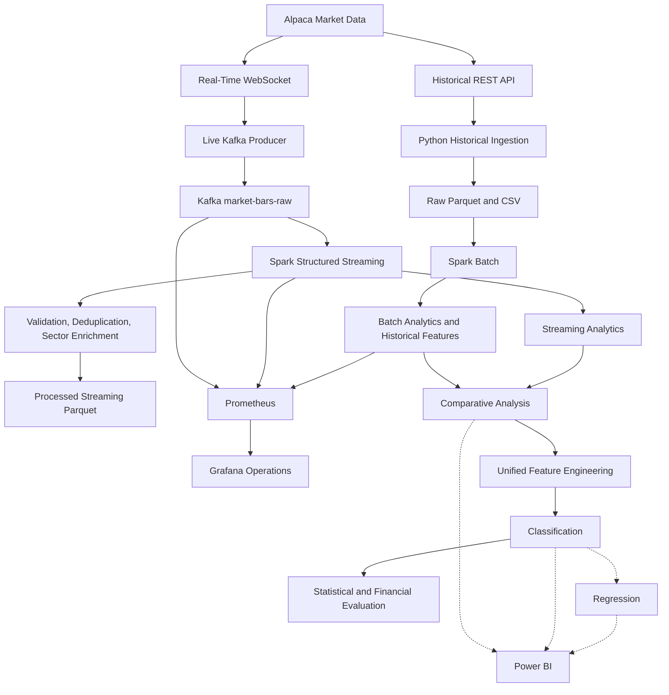
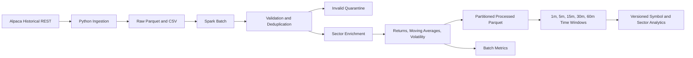
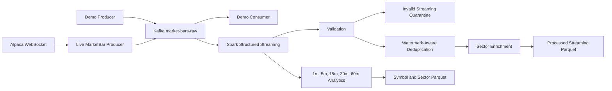
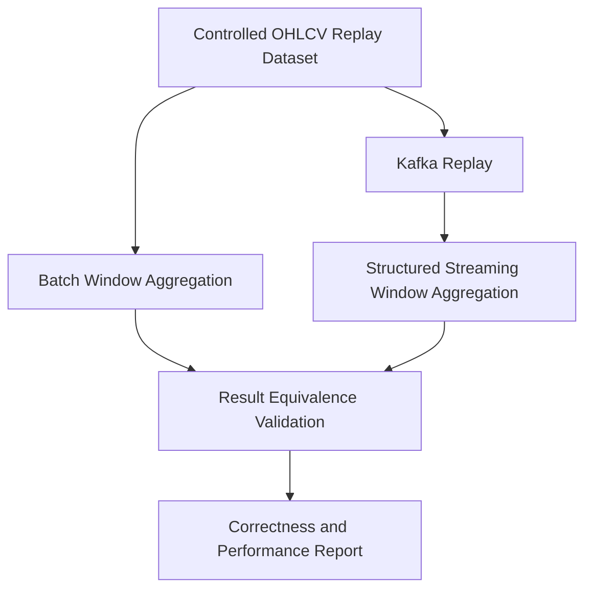

# Big Data Pipeline for Financial Market Analysis

## Project Objective

This university Big Data project studies financial market analysis through two
first-class processing paths: historical **Batch Analytics** and near-real-time
**Streaming Analytics**. Both paths use the same market domain, centralized symbol and
sector metadata, compatible OHLCV schemas, and equivalent mathematical definitions
wherever a metric exists in both modes.

The batch path is implemented through historical feature generation and versioned
1, 5, 15, 30, and 60-minute event-time analytics. The streaming
path is implemented through validated, deduplicated, sector-enriched event persistence:
Alpaca WebSocket, Kafka, and Spark Structured Streaming are runtime verified. Windowed
streaming analytics are implemented and runtime verified for 1, 5, 15, 30, and 60-minute
symbol and sector windows.

Phase 10 adds a frozen one-year ML dataset, leakage-safe financial features, exact
5/15/30-minute direction targets, chronological evaluation, three transparent baselines,
and CPU-trained LSTM/GRU models. Results are persisted for later Power BI integration;
regression remains a separate planned phase.

## Academic Context

The scientific objective is to compare batch and streaming processing for correctness,
throughput, latency, completeness, resource use, and operational behavior. Phase 7
established analytical equivalence through controlled replay, and Phase 8 measured
performance over four equivalent workload sizes with repeated isolated runs. Existing
historical benchmarks remain preserved as baselines and are not mixed with the
controlled comparison results.

## Architecture Overview

Solid nodes describe implemented components. Dashed nodes describe planned work.

### Overall Architecture



### Batch Architecture



### Streaming Architecture



### Future Batch vs Streaming Comparison



## Technologies

- Python 3.11+
- Alpaca Market Data API v2
- pandas and PyArrow
- Apache Spark / PySpark 4.0.1
- Eclipse Temurin Java 21 LTS
- Apache Kafka 4.3.1 in KRaft mode
- Confluent Python client for Apache Kafka
- websockets 17.1 asynchronous client
- Docker Compose for local Kafka and Windows Spark runtime infrastructure
- Prometheus 3.5.0, Kafka Exporter, and cAdvisor for operational metrics
- Grafana 12.1.1 with provisioned datasource and dashboard
- YAML configuration and environment variables
- pytest

Classification and deep learning are implemented. Regression and Power BI remain future phases.

## Project Structure

```text
.
|-- config/
|   `-- config.yaml
|-- Dockerfile.spark
|-- docker-compose.yml
|-- data/
|   |-- raw/
|   |-- processed/
|   `-- checkpoints/
|-- notebooks/
|   `-- 01_data_exploration.ipynb
|-- src/
|   |-- config/
|   |-- ingestion/
|   |-- kafka/
|   |   |-- create_topics.py
|   |   |-- demo_consumer.py
|   |   |-- demo_producer.py
|   |   |-- event_codec.py
|   |   `-- producer.py
|   |-- metrics/
|   |   |-- pipeline_metrics.py
|   |   `-- streaming_query_metrics.py
|   |-- models/
|   |-- processing/
|   |-- spark/
|   |   |-- batch_processor.py
|   |   |-- streaming_transformations.py
|   |   |-- structured_streaming_processor.py
|   |   `-- transformations.py
|   |-- storage/
|   |-- streaming/
|   |   |-- alpaca_websocket.py
|   |   |-- metrics.py
|   |   `-- realtime_ingestion.py
|   `-- main.py
|-- tests/
|   |-- test_alpaca_client.py
|   |-- test_kafka_event_codec.py
|   |-- test_kafka_producer.py
|   |-- test_normalization.py
|   |-- test_parquet_storage.py
|   |-- test_realtime_ingestion.py
|   |-- test_settings.py
|   |-- test_spark_batch.py
|   `-- test_spark_streaming.py
|-- scripts/
|   `-- validate_streaming_output.py
|-- README.md
`-- requirements.txt
```

## Setup

Create and activate a virtual environment:

```powershell
python -m venv .venv
.\.venv\Scripts\Activate.ps1
python -m pip install -r requirements.txt
```

Alpaca ingestion reads these environment variables, including from a local `.env`:

```env
APCA_API_KEY_ID=your_key_here
APCA_API_SECRET_KEY=your_secret_here
```

The Spark batch command does not load or require Alpaca credentials.

## Streaming Pipeline: Kafka Infrastructure

**Objective:** Phase 2 establishes and verifies the transport boundary used by the
live Alpaca source and Spark Structured Streaming. Its demo producer and consumer
remain useful independent transport diagnostics.

**Architecture and technologies:** A local single-node Apache Kafka 4.3.1 broker runs
in KRaft mode through Docker Compose, with no ZooKeeper dependency. Python clients use
`confluent-kafka`, and broker data persists in the `kafka-data` Docker volume.

**Configuration:** The `kafka` section of `config/config.yaml` defines bootstrap
servers, topic names, consumer-group prefix, client ID, partition count, replication
factor, and consumer timeout. No credentials are required for the local broker.

**Input, processing, and output:** The demo producer creates valid `MarketBar` objects,
the shared codec serializes them as versioned JSON, and `MarketBarProducer` publishes
them to `market-bars-raw` with `symbol` as the record key. The demo consumer decodes and
validates each record, verifies key/payload agreement, prints Kafka metadata and the
event, and commits the offset synchronously.

Start the broker and create the configured topics:

```powershell
docker compose up -d
docker compose ps
python -m src.kafka.create_topics
```

The topic command is idempotent. It creates:

- `market-bars-raw`: normalized market bar events
- `market-bars-dlq`: reserved for malformed or unprocessable events in later phases

Both topics use six partitions locally. A single broker requires replication factor
one; a multi-broker deployment should raise that value.

Start the demo consumer in one terminal:

```powershell
python -m src.kafka.demo_consumer --max-messages 10
```

Then publish deterministic events from another terminal:

```powershell
python -m src.kafka.demo_producer --count 10 --symbols AAPL MSFT
```

Each consumed line includes the topic, partition, offset, key, and decoded event. The
consumer validates that the Kafka key matches the payload symbol before committing its
offset. Stop the broker with `docker compose down`; add `-v` only when the persisted
local Kafka data should also be removed.

### Kafka Event Contract

`market-bars-raw` values are compact UTF-8 JSON with this shape:

```json
{"timestamp":"2026-09-29T14:30:00Z","symbol":"AAPL","open":100.0,"high":101.0,"low":99.5,"close":100.25,"volume":1000}
```

The Kafka record key is the uppercase `symbol`, preserving per-symbol ordering within
a partition. There is no global ordering guarantee across partitions. Headers contain
`event_type=market_bar` and `schema_version=1`; consumers can reject or route unknown
versions without guessing their schema. Sector is intentionally absent: consumers
enrich symbols from the centralized `symbols` mapping in `config/config.yaml`,
preventing duplicated reference data in every event.

| Field | JSON type | Meaning | Example | Validation |
|---|---|---|---|---|
| `timestamp` | string | Bar event time normalized to UTC | `2026-09-29T14:30:00Z` | Timezone-aware ISO 8601 |
| `symbol` | string | Uppercase market symbol | `AAPL` | Non-empty after normalization |
| `open` | number | Opening price | `100.0` | Finite, non-negative, within low/high |
| `high` | number | Highest price | `101.0` | Finite, non-negative, not below OHLC |
| `low` | number | Lowest price | `99.5` | Finite, non-negative, not above OHLC |
| `close` | number | Closing price | `100.25` | Finite, non-negative, within low/high |
| `volume` | integer | Traded volume represented by the bar | `1000` | Non-negative integer |

The codec applies the same basic market-bar validity rules used by the batch path:
finite and non-negative OHLC values, consistent high/low bounds, non-negative integer
volume, and a timezone-aware timestamp.

### Kafka Testing and Runtime Verification

Unit tests cover JSON round trips, required fields, invalid values, schema headers,
and symbol-key publication. Runtime verification used Docker Desktop 29.8.1, Docker
Compose 5.5.1, Kafka 4.3.1, and `confluent-kafka` 2.15.1:

- Broker health check passed on `localhost:9092`.
- `market-bars-raw` and `market-bars-dlq` each had six healthy partitions.
- Topic creation was idempotent.
- Ten events were acknowledged, consumed, decoded, and key-validated.
- Five AAPL events remained ordered in partition 0.
- Five MSFT events remained ordered in partition 1.

This ten-event smoke workload verifies transport correctness; it is not a throughput or
latency benchmark and is not directly comparable with the batch benchmark files. A
future Kafka benchmark will persist environment, workload, event-rate, and latency
measurements under `benchmarks/` without replacing existing results.

### Kafka Limitations and Future Integration

The current broker is a local development topology with one broker and replication
factor one, so it provides no broker-level fault tolerance. Authentication, TLS, dead
letter publication, retention tuning, production monitoring, and load benchmarks are
not yet implemented. `market-bars-dlq` is provisioned but no producer writes to it yet.

Phase 3 maps authenticated Alpaca WebSocket bar messages into the existing `MarketBar`
model and producer. Phase 4 parses that unchanged JSON, uses `timestamp` for event-time
processing, and enriches sector from central configuration. Neither integration
required a Kafka topic, key, payload, or schema-version change.

## Streaming Pipeline: Alpaca Real-Time Ingestion

**Objective:** Phase 3 adds only the live source to the existing streaming transport:

```text
Alpaca WebSocket -> MarketBar -> MarketBarProducer -> market-bars-raw
```

### Endpoint, Authentication, and Subscription

The production endpoint is `wss://stream.data.alpaca.markets/v2/iex`; the deterministic
off-hours endpoint is `wss://stream.data.alpaca.markets/v2/test`. After Alpaca sends
`connected`, the client sends the existing key and secret, requires an `authenticated`
response, subscribes to the `bars` channel, and requires a subscription confirmation.
Credentials remain loaded from the environment or `.env` and are never written to
logs or metrics.

Production runs use configured symbols from the centralized 30-symbol universe, or a
validated subset supplied with `--symbols`. Test runs always use Alpaca's `FAKEPACA`
symbol. The implementation consumes minute-bar messages (`T=b`) and ignores unrelated
data messages after handling protocol control and error messages.

### Mapping and Kafka Publishing

Alpaca fields map directly to the existing model and event contract:

| Alpaca field | `MarketBar` field | Kafka JSON field |
|---|---|---|
| `t` | `timestamp` | `timestamp` |
| `S` | `symbol` | `symbol` |
| `o` | `open` | `open` |
| `h` | `high` | `high` |
| `l` | `low` | `low` |
| `c` | `close` | `close` |
| `v` | `volume` | `volume` |

The existing codec remains the final validation boundary and normalizes timestamp and
symbol values before publication. The existing producer preserves `symbol` as the
Kafka key and uses `event_type=market_bar` and `schema_version=1` headers. Sector is
still enriched downstream from central configuration.

### Resilience and Error Handling

- The WebSocket receive buffer is bounded by configurable `max_queue` flow control.
- Network closures, timeouts, server errors, and slow-client errors reconnect with
  configurable exponential backoff and jitter.
- Authentication, invalid credentials, symbol-limit, connection-limit, entitlement,
  and invalid-subscription errors stop immediately instead of retrying forever.
- Malformed frames and invalid bars are counted, logged without credentials, and
  skipped without changing the Kafka contract.
- Cancellation closes the WebSocket; shutdown flushes Kafka before final metrics are
  persisted.
- `max_reconnect_attempts: 0` means unlimited retries; positive values establish a
  limit for consecutive connection attempts.

### Configuration and Commands

The `streaming` configuration section controls the channel, test symbol, bounded queue,
connection and ping timeouts, reconnect policy, Kafka flush timeout, and metrics path.
The `alpaca` section controls the stream base URL and feed.

Run against the always-available Alpaca test stream:

```powershell
python -m src.streaming.realtime_ingestion --test-stream --max-events 1 --duration-seconds 90
```

Run selected live IEX symbols:

```powershell
python -m src.streaming.realtime_ingestion --symbols AAPL MSFT --duration-seconds 300
```

Omit `--symbols` to subscribe to all 30 configured symbols. Omit both stopping options
for a continuous process, stopped with `Ctrl+C`. `--metrics-path` overrides the default
`data/processed/realtime_ingestion_metrics.json` output.

### Output and Metrics Schema

Successful bars are written to `market-bars-raw`; this phase creates no analytical
streaming output. Each run writes JSON metrics containing environment and workload,
endpoint/feed/channel, symbols, timestamps, duration, received and published events,
events per second, malformed and ignored messages, connections, reconnects, delivery
failures, status, and error details.

### Testing and Runtime Verification

Tests cover frame decoding, field mapping, connect/authenticate/subscribe sequencing,
unrelated messages, fatal authentication failures, reconnect/backoff, bounded queue
configuration, Kafka publication lifecycle, flush behavior, and persisted metrics.

Runtime verification on September 29, 2026 produced:

| Workload | Events | Duration | Events/sec | Reconnects | Malformed | Delivery failures |
|---|---:|---:|---:|---:|---:|---:|
| Alpaca test stream, FAKEPACA | 1 | 41.071 s | 0.024 | 0 | 0 | 0 |
| Live IEX, AAPL and MSFT | 2 | 45.353 s | 0.044 | 0 | 0 | 0 |

The existing consumer independently decoded and key-validated all three new records.
FAKEPACA was published to partition 5; AAPL and MSFT remained in their established
partitions 0 and 1. Results are preserved in
`benchmarks/alpaca_stream_test.json` and
`benchmarks/alpaca_stream_iex_2_symbols.json`.

These small event-time-limited runs verify protocol and transport correctness. Their
event rates reflect one-minute bar arrival timing and must not be interpreted as Kafka
capacity or compared directly with historical batch throughput.

### Phase 3 Limitations and Future Integration

IEX covers one exchange rather than the consolidated SIP market. Bar availability and
volume therefore depend on IEX activity, subscription entitlements, market hours, and
the selected symbols. The current client does not publish corrections or updated bars,
does not write malformed records to the provisioned DLQ, and has not been load-tested
across the full 30-symbol universe. Spark Structured Streaming remains a separate,
independently operated first-class path.

## Streaming Pipeline: Spark Structured Streaming

**Status: FULLY IMPLEMENTED AND RUNTIME VERIFIED.**

**Objective:** Phase 4 consumes `market-bars-raw` with Spark, preserves source
metadata, validates the versioned event contract, deduplicates by event identity, adds
sector metadata, and persists valid and rejected records. It deliberately stops before
windowed financial analytics, which belong to Phase 5.

```text
Alpaca WebSocket -> Kafka producer -> market-bars-raw
  -> Spark Structured Streaming
  -> parse/validate -> watermark deduplication -> sector enrichment
  -> processed streaming Parquet + invalid quarantine + checkpoints + metrics
```

### Processing Contract

Spark uses an explicit JSON schema, never schema inference. The JSON payload contains
`timestamp`, `symbol`, `open`, `high`, `low`, `close`, and `volume`. The Kafka source
also provides key, headers, topic, partition, offset, and Kafka record timestamp.

The producer uses uppercase `symbol` as the record key and sends
`event_type=market_bar` and `schema_version=1` headers. Phase 4 extracts and validates
`schema_version`, and validates that the Kafka key equals the payload symbol. Missing
or unsupported schema versions and malformed JSON are rejected. The `event_type`
header remains part of the input contract but is not currently validated or persisted
by the Spark output. Sector is joined from the central YAML mapping rather than added
to the Kafka payload.

Phase 4 rejects:

- malformed JSON, missing required payload fields, and missing or unsupported schema
  versions;
- a missing Kafka key or disagreement between the key and payload symbol;
- an unknown symbol without a configured sector;
- null OHLCV values, non-finite OHLC values, negative prices, or negative volume; and
- inconsistent bounds: high below low/open/close or low above open/close.

### Time, Watermark, and Deduplication

Valid rows use payload `timestamp` as event time. A configurable 10-minute watermark
and Spark's stateful `dropDuplicatesWithinWatermark` remove repeated
`(symbol, timestamp)` identities. Kafka `timestamp` is retained separately as
`kafka_timestamp`; it is not substituted for market event time. Records with unknown
symbols are quarantined because a reliable sector cannot be assigned.

These are three distinct timestamps:

- **Event time:** the payload market-bar `timestamp`; all financial event-time behavior
  uses this value.
- **Kafka time:** the broker record timestamp, retained as `kafka_timestamp`.
- **Processing time:** when Spark processes the row, retained as `processing_time`.

The watermark bounds the deduplication state. Logical event identity is
`symbol + timestamp`; sufficiently late events can be dropped once their event time is
behind the watermark.

Kafka is the continuous transport and retains records independently of Spark. Spark
Structured Streaming uses its default micro-batch execution model: each trigger reads
a bounded offset range and commits its progress to the checkpoint. Market event time
comes from the payload and is independent of Kafka arrival time, processing time, and
the wall-clock time of the micro-batch that happens to process it.

Two independently checkpointed queries write:

- `data/processed/streaming/`: valid Parquet, partitioned by `symbol` inside immutable
  micro-batch directories.
- `data/processed/streaming_invalid/`: rejected Parquet with `validation_errors`.
- `data/checkpoints/streaming/valid/` and `invalid/`: offsets, commits, and state.
- `data/processed/structured_streaming_metrics.json`: the latest run metrics.

These locations are separate from `data/processed/batch/` and
`data/processed/invalid/`; Batch and Streaming never share output directories.

The micro-batch writer commits through a temporary directory and then an atomic rename.
Existing batch IDs are not overwritten, making callback retries idempotent. Checkpoint
state remains the authority for Kafka offsets and watermark deduplication.
The valid checkpoint restores Kafka offsets and deduplication state-store data; the
invalid checkpoint restores its Kafka offsets. `startingOffsets` applies only when a
checkpoint identity is new. A same-checkpoint restart resumes recorded offsets and
state instead of applying the configured starting position again.

### Configuration and Commands

The `spark_streaming` YAML section controls the Spark application, official Kafka
connector coordinate, output and checkpoint paths, starting offsets, data-loss policy,
offset cap, watermark, trigger interval, and metrics path. Normal continuous operation:

```powershell
docker compose up -d --build
docker compose exec spark python3 -m src.spark.structured_streaming_processor `
  --bootstrap-servers kafka:29092
```

Process all currently available records and stop, which is useful for reproducible
validation and recovery checks:

```powershell
docker compose exec spark python3 -m src.spark.structured_streaming_processor `
  --bootstrap-servers kafka:29092 --available-now
python scripts/validate_streaming_output.py
```

`--run-seconds`, `--starting-offsets`, and all output/checkpoint/metrics paths have CLI
overrides. Starting offsets affect only a new checkpoint; a restarted query resumes its
recorded Kafka offsets. Delete checkpoints only when intentionally starting a new
stream identity.

On Linux or a Windows installation with a complete native Hadoop runtime, the Python
module can run directly. The verified host is Windows 11 with Java 21. Its Spark
runtime uses the official Spark 4.0.1 Java 21 Python Docker image because local Windows
Structured Streaming checkpoint/filesystem operations require Hadoop-native behavior
that Java alone does not provide. The project does not recommend unverified native
Hadoop binaries.
The broker retains `localhost:9092` for host producers and exposes `kafka:29092` only
inside Compose. No event or producer contract changes are required.

### Output Schema and Metrics

Valid output contains market fields (`timestamp`, `symbol`, `sector`, OHLCV), protocol
metadata (`schema_version`, Kafka key/topic/partition/offset/timestamp),
`processing_time`, `validation_errors`, and `is_valid`. Invalid output additionally
keeps `raw_value` and `corrupt_record` for diagnosis.

Metrics record Spark/Python/OS versions, connector and topic, paths and watermark,
duration, input/valid/invalid/duplicate counts, rates, active symbols, observed Kafka
partitions, per-query micro-batch output, Spark source offsets, event-time watermark,
and state-store statistics. Phase 4 evidence files are:

- `benchmarks/spark_streaming_deterministic.json`: deterministic Kafka-to-Spark
  processing evidence, not a controlled performance benchmark;
- `benchmarks/spark_streaming_recovery.json`: same-checkpoint offset and state recovery;
- `benchmarks/spark_streaming_late_data.json`: verified watermark-drop behavior;
- `benchmarks/spark_streaming_live.json`: Spark side of the off-hours live attempt; and
- `benchmarks/alpaca_stream_phase4_live.json`: Alpaca side of that live attempt.

### Testing and Runtime Verification

The complete test suite reports 37 passed, 0 failed, and 0 skipped. Spark streaming
tests cover explicit schema parsing, malformed events, missing or unsupported schema
versions, key/payload mismatch, OHLC validation, unknown-sector quarantine, event-time
conversion, sector enrichment, and construction of a watermark-aware deduplication
plan. Header extraction uses null-safe Spark 4 parsing so a missing schema header is
quarantined rather than terminating the query.

Runtime verification on September 29, 2026 used retained Phase 2/3 traffic plus a
controlled six-sector workload. The first run read 25 Kafka records and produced 18
valid rows, 6 invalid rows, and 1 dropped duplicate in 20.099 seconds. It processed all
available offsets with no rows behind latest. Actual Phase 3 IEX bars for AAPL and MSFT
were present in the valid output.

A restart with the same checkpoint read only 2 new records, restored six state-store
partitions, emitted 1 new MSFT row, and dropped 1 repeated AAPL identity in 16.527
seconds. Final disk validation found 19 valid rows, 6 invalid rows, zero duplicate
`(symbol, timestamp)` keys, zero sector mismatches, and zero invalid flags in valid
output. Technology, Healthcare, Defense, Aerospace, Energy, and Financial sectors were
all represented.

A third restart submitted one otherwise-valid JNJ record with event time 16 minutes
behind the current maximum. Spark read the record, reported
`numRowsDroppedByWatermark=1`, emitted no valid or invalid row, and left the validated
19-row output unchanged. This confirms that the configured 10-minute late-data bound
is enforced by the stateful query.

An additional 70-second live AAPL/MSFT attempt authenticated and subscribed successfully
while Spark ran for 100 seconds on the recovered checkpoint. It occurred after regular
US market hours and Alpaca emitted no new minute bars, so both sides correctly recorded
zero new events and clean shutdowns. The earlier Phase 3 real IEX AAPL/MSFT bars at
19:52 UTC were consumed from retained Kafka offsets and verified in Phase 4 Parquet.
The off-hours evidence is retained in `benchmarks/alpaca_stream_phase4_live.json` and
`benchmarks/spark_streaming_live.json`.

### Phase 4 Limitations

The environment has one local Kafka broker and one local Spark container/worker, not
production cluster fault tolerance. Rejected records are persisted to
`data/processed/streaming_invalid/`; although `market-bars-dlq` exists, Phase 4 does not
publish to it. Events later than the 10-minute watermark may be dropped. Runtime
workloads are small verification runs, not controlled performance benchmarks, and the
off-hours live attempt received no new bars. IEX is not consolidated SIP market data.
Financial streaming windows, aggregates, alerts, and other analytics are not
implemented in Phase 4.

## Java Runtime on Windows

Java 21 LTS is the verified project JDK. Install Eclipse Temurin 21 in PowerShell:

```powershell
winget install --id EclipseAdoptium.Temurin.21.JDK -e
```

Open a new terminal. If the installer did not configure `JAVA_HOME`, set it in
Windows System Properties > Environment Variables to the installed JDK directory,
then add `%JAVA_HOME%\bin` to `Path`. Verify:

```powershell
java -version
javac -version
$env:JAVA_HOME
```

For a temporary PowerShell session configuration:

```powershell
$env:JAVA_HOME="C:\Program Files\Eclipse Adoptium\jdk-21.0.12.101-hotspot"
$env:Path="$env:JAVA_HOME\bin;$env:Path"
```

## Configuration

[config/config.yaml](config/config.yaml) centrally defines symbols and sectors:

- Technology: AAPL, MSFT, NVDA, GOOGL, AMD
- Healthcare: JNJ, PFE, LLY, MRK, ABBV
- Defense: LMT, NOC, GD, RTX, HII
- Aerospace: BA, TDG, HEI, TXT, GE
- Energy: XOM, CVX, COP, SLB, OXY
- Financial: JPM, BAC, GS, MS, V

Add a symbol and its sector under `symbols` to extend both ingestion and Spark
enrichment. The `spark` section controls the application name, local master, input,
valid output, invalid output, and metrics paths.

## Market Universe

The verified universe intentionally contains 30 companies across six sectors, enabling
both individual-company analysis and later `groupBy("sector")` comparisons. Defense
and Aerospace remain separate project classifications even where business activities
overlap.

The originally proposed Aerospace ticker `SPR` was replaced by `GE`: Alpaca reported
SPR as inactive and non-tradable and returned no IEX bars for the configured period.
GE was verified as active, tradable, and available through the same feed and period.
All other proposed symbols were active and returned usable historical bars.

## Batch Pipeline

The batch path remains an active analytical path, not legacy setup. It converts a
configurable historical period into validated, sector-enriched, per-symbol time series
that support company, sector, and later cross-path analysis.

### Historical Ingestion

```powershell
python -m src.main
```

This writes one raw Parquet file and one CSV file per symbol, for example:

```text
data/raw/AAPL/2026-09-01_2026-09-20_1Min.parquet
data/raw/AAPL/2026-09-01_2026-09-20_1Min.csv
```

### Spark Batch Processing

Process every configured symbol that has raw data:

```powershell
python -m src.spark.batch_processor
```

Process one or more selected symbols:

```powershell
python -m src.spark.batch_processor --symbols AAPL
python -m src.spark.batch_processor --symbols AAPL MSFT
```

Spark reads only raw Parquet files. It does not call Alpaca. Valid processed data is
written under `data/processed/batch`, partitioned by symbol. Re-running a batch uses
dynamic partition overwrite, so selected symbol partitions are replaced rather than
appended.

Full runs replace stale generated partitions, while raw folders outside the configured
universe remain untouched.

On local Windows systems without Hadoop's native `winutils.exe`, Spark performs all
transformations and the pipeline uses a schema-preserving PyArrow writer for local
partition persistence. This avoids introducing an unverified native executable.

### Batch Data Quality

Every raw row receives `is_valid` and `validation_errors`. Validation covers required
values, OHLC consistency, non-negative prices, and non-negative volume. Quality-invalid
records are preserved under `data/processed/invalid`.

`symbol + timestamp` is the logical identity. Quality-valid duplicate extras are
marked with `duplicate_symbol_timestamp`, moved to the invalid dataset, and excluded
from financial calculations. One deterministic row remains in the valid dataset.
Nothing is silently discarded.

Metric meanings:

- `valid_row_count`: quality-valid rows before deduplication.
- `invalid_row_count`: rows failing financial data-quality checks.
- `duplicate_count`: duplicate extras among quality-valid rows.
- `output_row_count`: quality-valid rows after deduplication.

### Batch Output Schema and Financial Features

The valid output contains:

```text
timestamp, symbol, sector, open, high, low, close, volume,
validation_errors, is_valid, previous_close, price_change, return_pct,
log_return, previous_volume, volume_change, ma_5, ma_15, ma_30,
rolling_volatility_30
```

All lag and rolling calculations partition by `symbol` and order by `timestamp`.
Moving averages require their complete 5, 15, or 30-row history. Volatility is the
sample standard deviation of 30 returns. Values remain null until sufficient history
exists. A previous close of zero also produces null percentage and log returns.

## Shared Analytical Definitions

Batch implements the definitions below. Streaming windows use the explicitly related,
but not identical, definitions documented in the Phase 5 section:

- `price_change = close_t - close_(t-1)`
- `return_pct = (close_t - close_(t-1)) / close_(t-1)` when the previous close is positive
- `log_return = ln(close_t / close_(t-1))` when both closes are positive
- `volume_change = volume_t - volume_(t-1)`
- `ma_N = arithmetic mean of the current and previous N-1 closes` after N observations
- `rolling_volatility_30 = sample standard deviation of 30 return_pct observations`

For later equivalence experiments, window boundaries, event ordering, null warm-up
behavior, sample versus population standard deviation, and numerical tolerance must be
declared before comparing batch and streaming results.

## Batch Metrics and Benchmarks

Each run logs and saves `data/processed/batch_metrics.json` with:

- Input, quality-valid, invalid, duplicate, and output row counts
- Processing duration and input rows per second
- Number and names of processed symbols
- Input and output sizes in bytes

These metrics form the batch baseline for the later streaming comparison.

### Initial Verified Batch Baseline

Recorded on Windows with Python 3.11.9, Eclipse Temurin Java 21.0.12.1, Spark
4.0.1, and PySpark 4.0.1:

- Symbols: 5
- Input rows: 25,570
- Output rows: 25,570
- Input size: 662,852 bytes
- Output size: 2,292,802 bytes
- Processing duration: 25.607 seconds
- Throughput: 998.548 rows/second
- Invalid rows: 0
- Duplicate rows: 0

This is an initial local-development baseline, not a controlled performance study.

### Expanded Universe Batch Baseline

The verified 30-symbol, six-sector run produced:

- Input/output rows: 113,988
- Input size: 2,857,816 bytes
- Output size: 9,880,026 bytes
- Processing duration: 52.706 seconds
- Throughput: 2,162.713 rows/second
- Invalid rows: 0
- Duplicate rows: 0

An idempotency rerun retained the same rows, partitions, and byte size. Full benchmark
records are stored separately in `benchmarks/batch_5_symbols.json` and
`benchmarks/batch_30_symbols.json`.

## Testing

Run all tests:

```powershell
python -m pytest
```

Run only non-Spark tests:

```powershell
python -m pytest tests/test_alpaca_client.py tests/test_normalization.py tests/test_parquet_storage.py
```

Validate an actual generated batch dataset:

```powershell
python scripts/validate_batch_output.py
```

Validate all configured raw datasets:

```powershell
python scripts/validate_raw_data.py
```

Spark tests use small in-memory deterministic datasets and never call Alpaca. The
Kafka and WebSocket unit tests do not require external services; documented runtime
smoke tests do. The complete suite currently reports 51 passed, 0 failed, and 0 skipped
and is verified on Java 21. The 17 emitted warnings are upstream PySpark/Pandas
deprecation warnings.

## Known Limitations

- Historical and live coverage use [Alpaca's IEX feed](https://docs.alpaca.markets/us/docs/market-data-faq),
  which represents one exchange rather than the consolidated US market and therefore
  reports lower volume than SIP data.
- The local Kafka topology has one broker and replication factor one.
- The ten-event Kafka run is a transport smoke test, not a performance benchmark.
- Phase 5 evidence is a functional runtime validation, not a controlled performance benchmark.
- Phase 4 records later than the configured watermark may be dropped.
- Phase 4 invalid records use local Parquet quarantine rather than `market-bars-dlq`.
- The local Spark runtime is a single Docker worker, not a production cluster.
- The Phase 4 workloads are small verification runs; the off-hours live attempt
  received no new bars.
- Live ingestion currently handles Alpaca minute bars only; updated bars, corrections,
  trades, and quotes are outside Phase 3.
- Current batch features are row-count windows, not elapsed-time windows; missing
  market intervals can therefore affect comparisons with future event-time windows.
- Current benchmarks were captured on one Windows development machine and cannot be
  generalized as cluster-scale performance.

## Current Status

Implemented and runtime verified:

- Alpaca historical API client with pagination
- OHLCV normalization and ingestion validation
- Raw CSV and Parquet persistence
- Central symbol/sector configuration
- Verified 30-company, six-sector historical market universe
- Per-symbol ingestion failure isolation and summary reporting
- Independent Spark batch input discovery for one, multiple, or all symbols
- Spark validation, quarantine, deterministic deduplication, and sector enrichment
- Lagged returns, moving averages, and rolling volatility
- Idempotent partitioned processed Parquet output
- Reusable JSON batch metrics
- Unit and deterministic Spark tests
- Real full and selected-symbol batch execution on Java 21
- Output schema, uniqueness, sector, feature, null-window, and idempotency validation
- Separate five-symbol and expanded-universe benchmark artifacts
- Versioned JSON market-bar event codec and validation tests
- Symbol-keyed idempotent Kafka producer
- Validating demo Kafka consumer with explicit offset commits
- Idempotent Kafka topic administration
- Single-node Apache Kafka KRaft Docker Compose definition
- Healthy Kafka 4.3.1 runtime with six partitions per topic
- Verified ten-event AAPL/MSFT producer-to-consumer transport
- Authenticated Alpaca WebSocket client and `bars` subscription
- Config-driven 30-symbol or selected-symbol real-time ingestion
- Existing `MarketBar` and Kafka contract reuse with no schema change
- Bounded receive buffering and configurable reconnect backoff with jitter
- Clean Kafka flush and JSON streaming-ingestion metrics on shutdown
- Verified FAKEPACA test-stream bar through Kafka
- Verified live AAPL/MSFT IEX bars through Kafka
- Preserved Phase 3 test and live runtime measurement artifacts
- Explicit Spark Kafka JSON schema with protocol and market-data validation
- Event-time watermarking and stateful `(symbol, timestamp)` deduplication
- Streaming sector enrichment and separate invalid-record quarantine
- Idempotent micro-batch Parquet output with durable valid/invalid checkpoints
- Structured Streaming progress, offset, state-store, and throughput metrics
- Official Spark 4.0.1 Java 21 Docker runtime for local Windows development
- Verified six-sector Kafka-to-Spark run and checkpoint restart recovery
- Verified a late event is dropped after the 10-minute watermark
- Preserved deterministic and restart streaming benchmark artifacts
- Versioned Dataset V1 manifest and idempotent overlapping historical refresh
- Event-time 1, 5, 15, 30, and 60-minute symbol and sector analytics
- Separate duration checkpoints and Parquet outputs for reliable watermark finalization
- Phase 5 runtime evidence covering all six sectors
- Version-aware Phase 6 Batch time-window analytics for symbols and sectors
- Verified trading-day isolation and DST-aware regular-session filtering
- Preserved row-count features beside the new elapsed-time analytical layer
- Centrally configured 1/5/15/30/60-minute Batch and Streaming windows
- Per-window expected event counts, coverage ratios, and completeness evidence

Planned, not implemented:

- Batch vs streaming correctness and performance experiments
- Advanced indicators and machine-learning models
- Paper trading

## Dataset Versions and Historical Refresh

The verified September dataset is registered as **Baseline Dataset V1** in
`datasets/manifests/dataset_v1.json`. The manifest fixes the source, feed, configured
universe, observed dates, row count, raw and processed sizes, and the regular-session
policy without moving the existing files or changing the preserved batch benchmarks.
`dataset.active_version` identifies the active development version.

Development data may be refreshed or expanded. Experiment data is different: before
Phases 7 and 8, a named version such as `final_experiment_v1` must be frozen with exact
dates, symbols, sectors, feed, timeframe, session policy, row count, and checksums. A
frozen experiment version must never be overwritten, and every scientific benchmark
must name that version.

Historical refresh accepts a date range and either the full configured universe or a
configured subset:

```powershell
python -m src.main --start 2026-10-01 --end 2026-10-31
python -m src.main --start 2026-10-01 --end 2026-10-31 --symbols AAPL MSFT
```

Each request is stored under its own date-range filename. Before writing, storage merges
an existing same-range file and removes identities already present in every other raw
file for that symbol. The logical identity is `(symbol, timestamp)`, making repeated or
overlapping refreshes idempotent while retaining failure isolation per symbol. The
original V1 files and benchmarks are not replaced.

Raw data retain regular and pre/post-market observations. The configurable
`dataset.regular_session_only` policy is applied only to analytics; it never deletes raw
events. Missing minutes are measured rather than filled: no synthetic prices or
forward-fill are introduced. Existing Phase 1 row-count windows remain unchanged.
Phase 6 intraday analytics group by symbol and New York trading date. Continuous
historical and overnight returns remain separate concepts and are not mixed implicitly.

## Phase 5 Streaming Financial Analytics

Phase 5 consumes the Phase 4 validated, deduplicated, sector-enriched event-time stream
and emits configured 1, 5, 15, 30, and 60-minute analytical windows. Outputs do not overwrite
Phase 4 events:

- symbol analytics: `data/analytics/streaming/symbol`
- sector analytics: `data/analytics/streaming/sector`
- checkpoints: `data/checkpoints/streaming_analytics`
- versioned evidence: `benchmarks/streaming_phase5_v1.json`

Each duration has an independent query and checkpoint. Its output is stored below a
`duration=1_minute`, `duration=5_minutes`, or `duration=15_minutes` directory so
watermark finalization is independent and the embedded `window_duration` column
remains unambiguous.

Per-symbol windows contain average/minimum/maximum close, event-time first/last close,
total volume, event count, window return, and volatility. Window return is
`(last_close - first_close) / first_close`; it is distinct from Phase 1 row-to-row
return. Phase 5 volatility is the sample standard deviation of source-bar returns
`(close - open) / open` inside the window. It is null with fewer than two valid returns.
Missing minutes remain absent, windows are ordered by event time, and late events follow
the existing ten-minute watermark. Sector windows provide appropriate pooled price,
volume, event, symbol-count, and volatility measures; Defense and Aerospace remain
separate configured sectors.

Deterministic tests cover boundaries, first/last ordering, average/min/max, volume,
count, return, volatility, multiple symbols and sectors, sparse minutes, regular-session
filtering, and the upstream watermark/deduplication contract. Phase 6 reproduces these
definitions in Batch as documented below.

Runtime validation on October 12, 2026 processed 120 controlled Kafka events for one
symbol in each configured sector. It emitted 120 valid records, zero invalid records,
and zero duplicates in 39.370 seconds. Both symbol and sector sinks emitted 54
one-minute, 12 five-minute, and 6 fifteen-minute finalized windows. All six sectors
and the six selected symbols were present. The analytics output occupied 121,478 bytes.
This small single-worker run proves behavior and persistence; it is not a throughput
or scalability benchmark.

## Phase 6 Batch Analytics Extension

Phase 6 reads the active version from `dataset.active_version` and processes the
existing historical output without modifying `data/processed/batch`. Run it with:

```powershell
python -m src.spark.batch_analytics
```

Outputs are written to `data/analytics/batch/<dataset_version>/symbol` and
`data/analytics/batch/<dataset_version>/sector`, with separate `duration=1_minute`,
`duration=5_minutes`, `duration=15_minutes`, `duration=30_minutes`, and
`duration=60_minutes` directories. Every row carries
`dataset_version`, `trading_date`, window boundaries, and duration. Generation
evidence for the extended run is stored in
`benchmarks/batch_analytics_windows_1m_5m_15m_30m_60m_<dataset_version>.json`.

These elapsed-time windows do not replace the Phase 1 row-count features `ma_5`,
`ma_15`, `ma_30`, and `rolling_volatility_30`. Missing minutes are not synthesized, so
a five-minute symbol window may contain fewer than five observations; `event_count`
and benchmark coverage counts expose that condition. `trading_date` is derived in
`America/New_York` and included in every grouping key. If enabled, the shared regular
session filter keeps 09:30 inclusive through 16:00 exclusive with DST awareness.

### Phase 5/6 Definition Consistency

| Metric | Streaming definition | Batch definition | Equivalent? |
|---|---|---|---|
| `average_price` | Mean of observed close values | Mean of observed close values | Yes |
| `minimum_price` | Minimum observed close | Minimum observed close | Yes |
| `maximum_price` | Maximum observed close | Maximum observed close | Yes |
| `first_price` | Close at minimum event timestamp | Close at minimum event timestamp | Yes |
| `last_price` | Close at maximum event timestamp | Close at maximum event timestamp | Yes |
| `total_volume` | Sum of observed volume | Sum of observed volume | Yes |
| `event_count` | Number of observed valid events | Number of observed valid events | Yes |
| `window_return` | `(last_price-first_price)/first_price` | `(last_price-first_price)/first_price` | Yes |
| `volatility` | Sample standard deviation of `(close-open)/open` | Sample standard deviation of `(close-open)/open` | Yes |

Both paths align fixed, half-open Spark windows in UTC: `window_start <= timestamp <
window_end`. Volatility is null when fewer than two valid bar returns exist. Sector
analytics intentionally omit first/last/window return, matching Phase 5, because a
pooled sector has simultaneous observations from multiple symbols without one unique
sector price sequence. The retained sector `volatility` field is therefore the sample
dispersion of all observed individual-stock bar returns pooled inside the
sector/window. It combines temporal and cross-sectional dispersion; it is not the
temporal volatility of a separately constructed sector-return series.

Runtime validation on October 12, 2026 used Dataset V1 with the full-session policy.
All 113,988 input rows remained after filtering. The run represented 30 symbols and
six sectors and produced 113,988/29,580/10,277 symbol windows and
30,290/6,249/2,124 sector windows for 1/5/15 minutes respectively. Processing took
36.027 seconds at 3,164.002 input rows/second and wrote 6,489,385 bytes. No duplicate
analytical keys or trading-date mismatches were found. A real AAPL five-minute window
(`2026-09-01 13:30-13:35 UTC`) was independently recalculated from five processed
bars: return `-0.0042942848` and volatility `0.0011661492`, together with every price,
volume, and count value, matched the Spark output.

## Larger Analytical Windows and Coverage

The shared `analytics.window_durations` configuration now defines `1 minute`,
`5 minutes`, `15 minutes`, `30 minutes`, and `60 minutes` once for both Batch and
Streaming. Larger windows reuse every Phase 5/6 formula and output layout. Each symbol
row includes nominal `expected_event_count`, observed `event_count`, and
`coverage_ratio = event_count / expected_event_count`. For a sector, the denominator
is nominal minutes multiplied by `active_symbols`. Incomplete windows are measured and
persisted, never filtered or filled.

Fixed windows remain UTC-aligned and half-open. With regular-session filtering, the US
close (20:00 UTC during daylight time and 21:00 UTC during standard time) lies on an
hour boundary, so the final 60-minute session window ends at the close. The 09:30 open
falls halfway through its UTC hour; that first nominal 60-minute window is therefore
expected to have at most 30 regular-session observations. Coverage records this
alignment rather than manufacturing data. `trading_date` grouping prevents any Batch
window from mixing observations from different New York trading dates.

### Dataset V1 Coverage Summary

The historical symbol outputs provide the most representative current coverage view:

| Window | Total | Complete | Incomplete | Avg. coverage | Median events | Valid volatility |
|---|---:|---:|---:|---:|---:|---:|
| 1m | 113,988 | 113,988 | 0 | 100.00% | 1 | 0.00% |
| 5m | 29,580 | 14,316 | 15,264 | 77.07% | 4 | 91.39% |
| 15m | 10,277 | 3,373 | 6,904 | 73.94% | 12 | 98.09% |
| 30m | 5,195 | 1,365 | 3,830 | 73.14% | 24 | 98.65% |
| 60m | 2,800 | 476 | 2,324 | 67.85% | 43 | 98.75% |

The declining nominal coverage reflects missing IEX minutes and partial boundary
windows. The increasing availability of volatility reflects the greater chance of
having at least two observed returns. Larger windows may yield estimates based on more
observations, but this run does not establish that they are automatically better;
stability, responsiveness, missing-data sensitivity, and usable sample counts still
require later controlled analysis.

Streaming runtime validation consumed 600 valid Kafka events with zero invalid or
duplicate events. It finalized 24 symbol and 24 sector 30-minute windows, including 6
complete windows per level, at 59.17% average coverage. It finalized 18 symbol and 18
sector 60-minute windows; all were incomplete in this bounded retained workload, with
39.44% average coverage. The run is functional evidence, not a market-data benchmark.
Its evidence is stored in
`benchmarks/streaming_analytics_windows_1m_5m_15m_30m_60m_v1.json`.

Manual Dataset V1 checks used complete AAPL windows. The 30-minute window
`2026-09-01 13:30-14:00 UTC` contained 30 events, return `0.0190243132`, volatility
`0.0017072625`, and 100% coverage. The 60-minute window
`2026-09-01 14:00-15:00 UTC` contained 60 events, return `0.0038064586`, volatility
`0.0009561299`, and 100% coverage. Independent recalculation matched average,
minimum, maximum, first and last close, volume, count, return, volatility, and coverage.

## Next Steps Roadmap

Recommended order is Phase 2 through Phase 12 because each phase establishes the
contracts, data, or measurements required by the following phase.

### Phase 2 - Kafka Infrastructure

- **Status:** Implemented and runtime verified with Docker Desktop 29.8.1 and Compose 5.5.1.
- **Architecture change:** Added a broker between future producers and consumers, with `market-bars-raw` and `market-bars-dlq` topics.
- **Files/components:** Docker Compose, topic administration, centralized configuration, demo producer/consumer, and a versioned JSON contract.
- **Technologies:** Apache Kafka 4.3.1 in KRaft mode, Docker Compose, and `confluent-kafka`.
- **Tests:** Serialization round trip, validation, schema headers, and symbol-key behavior.
- **Expected output:** A repeatable broker and normalized event contract ready for live bars and Spark.
- **Dependency:** Phase 1 schema and symbol configuration.
- **Complexity:** Medium.

### Phase 3 - Alpaca Real-Time Streaming

- **Status:** Implemented and runtime verified with both Alpaca test and live IEX streams.
- **Objective:** Publish normalized live Alpaca bars to Kafka.
- **Architecture change:** Add `Alpaca WebSocket -> MarketBar -> existing Kafka producer -> market-bars-raw` beside the independent historical path.
- **Endpoint:** Use the documented [Alpaca stock WebSocket](https://docs.alpaca.markets/us/docs/real-time-stock-pricing-data) at `wss://stream.data.alpaca.markets/v2/iex` for the configured IEX feed and the Alpaca test endpoint for deterministic off-hours verification.
- **Authentication/subscription:** Follow the documented [connection protocol](https://docs.alpaca.markets/us/docs/streaming-market-data): authenticate once per connection with the existing API key and secret, wait for confirmation, then subscribe to the `bars` channel for configured symbols.
- **Mapping:** Convert Alpaca `T=b`, `t`, `S`, `o`, `h`, `l`, `c`, and `v` fields to the existing `MarketBar`; ignore unrelated message types after handling protocol messages.
- **Resilience:** Add configurable exponential reconnect backoff with jitter, clean cancellation, bounded buffering, and explicit handling for authentication, entitlement, connection-limit, slow-client, malformed-message, and Kafka-delivery failures.
- **Files/components:** Async WebSocket client, live-bar mapper, orchestration entry point, streaming settings, producer lifecycle handling, and producer metrics.
- **Technologies:** Alpaca stock WebSocket API, `asyncio`, a maintained WebSocket client, existing `confluent-kafka` producer, and structured logs.
- **Tests:** Mock connect/authenticate/subscribe flows, bar mapping, unrelated/control messages, malformed events, reconnect/backoff, shutdown flush, and a local Kafka integration test.
- **Runtime verification:** FAKEPACA produced one event in 41.071 seconds; live AAPL/MSFT produced two events in 45.353 seconds. All events were Kafka-consumed and key-validated with zero malformed records, reconnects, or delivery failures.
- **Expected output:** Symbol-keyed normalized events on `market-bars-raw`.
- **Dependency:** Phase 2 broker and message contract.
- **Complexity:** High.

### Phase 4 - Spark Structured Streaming

- **Status:** FULLY IMPLEMENTED AND RUNTIME VERIFIED.
- **Objective:** Consume Kafka events reliably and create processed streaming data.
- **Architecture change:** Added `Kafka -> Spark Structured Streaming -> Parquet` with durable checkpoints.
- **Files/components:** Streaming entry point, explicit event schema, Kafka reader, checkpoint configuration, watermark/deduplication logic, sector enrichment, valid/invalid writers, validator, and progress metrics.
- **Technologies:** Spark Structured Streaming 4.0.1, official Spark Kafka connector, Parquet, and the official Java 21 Spark Docker image.
- **Tests:** Schema decoding, protocol/data validation, event-time handling, sector enrichment, watermark/deduplication plan, real Kafka processing, and checkpoint restart.
- **Runtime verification:** 25 inputs produced 18 valid rows, 6 invalid rows, and 1 dropped duplicate; restart consumed only 2 new inputs, emitted 1, and dropped the repeated identity. A later restart dropped one event behind the watermark. Final output had 19 unique valid rows and zero sector mismatches.
- **Output:** Validated, deduplicated event-time streaming records and rejected records, ready for downstream phases.
- **Dependency:** Phases 2 and 3.
- **Complexity:** High.

### Phase 5 - Streaming Financial Analytics

- **Status:** FULLY IMPLEMENTED AND RUNTIME VERIFIED.
- **Objective:** Produce useful near-real-time market aggregates.
- **Architecture change:** Add windowed analytics after streaming validation.
- **Files/components:** Window transformations, per-duration analytics sinks and checkpoints, session filtering, and metric definitions.
- **Technologies:** Spark SQL windows and Structured Streaming state.
- **Tests:** Average/min/max price, volume, event count, first/last price, short return, volatility, sector separation, sparse minutes, and regular-session boundaries.
- **Runtime verification:** 120 valid events, zero invalid/duplicate events, and finalized 1, 5, and 15-minute outputs for symbols and all six sectors; evidence is stored in `benchmarks/streaming_phase5_v1.json`.
- **Expected output:** Per-symbol and per-sector 1, 5, 15, 30, and 60-minute analytics outputs.
- **Dependency:** Phase 4 event-time pipeline.
- **Complexity:** Medium.

### Phase 6 - Batch Analytics Extension

- **Status:** FULLY IMPLEMENTED AND RUNTIME VERIFIED.
- **Objective:** Add historical symbol, sector, and time-window analytics equivalent to the streaming measures where appropriate.
- **Architecture change:** Extend the first-class batch path after feature generation.
- **Analytics:** Phase 5-equivalent average/min/max close, volume, event count, deterministic first/last price, window return, sample bar-return volatility, and active sector symbol count.
- **Tests:** Symbol and sector isolation, 1/5/15/30/60-minute boundaries, formulas, event ordering, coverage, missing intervals, trading-day separation, DST-aware sessions, and dataset-version propagation.
- **Runtime verification:** Dataset V1 produced all durations for 30 symbols and six sectors with zero duplicate analytical keys; evidence is stored in `benchmarks/batch_analytics_phase6_v1.json`.
- **Expected output:** Historical per-symbol and per-sector analytical datasets.
- **Dependency:** Stable Phase 1 batch output and Phase 5 metric definitions.
- **Complexity:** Medium.

### Phase 7 - Batch vs Streaming Equivalence

- **Status:** FULLY IMPLEMENTED AND RUNTIME VERIFIED.
- **Objective:** Establish numerical correctness across both processing paradigms.
- **Architecture change:** Added a deterministic, checksummed OHLCV workload, an isolated Kafka replay topic, versioned outputs, and an automated reconciliation report.
- **Tests:** Feed identical 1, 5, 15, 30, and 60-minute sequences through both paths and reconcile average/min/max price, volume, return, volatility, and coverage within declared tolerances.
- **Runtime verification:** `phase7_controlled_v1` contains 392 records over two trading days, four symbols, and three sectors. Batch and Streaming each removed two duplicate identities and produced matching symbol/sector row counts at every duration. All 556 symbol rows and 386 sector rows reconciled with zero missing or mismatched rows. Floating-point differences were at most `5.684341886080802e-14` for averages and `2.710505431213761e-20` for volatility, below the declared absolute/relative tolerance of `1e-10`.
- **Evidence:** Input and manifest are under `datasets/equivalence/`; the persisted report is `benchmarks/phase7_controlled_v1_equivalence.json`, with separate Batch and Streaming runtime metrics beside it.
- **Window policy:** Both paths use fixed, half-open, UTC clock-aligned windows and a New York `trading_date`. Session-aligned windows are a possible later analytical variant, not part of this correctness baseline.
- **Sector interpretation:** Sector volatility remains the sample dispersion of pooled constituent bar returns inside each window, not the temporal volatility of a synthetic sector-return series.
- **Expected output:** Persisted correctness report with inputs, formulas, precision, mismatches, and explanations. Delivered.
- **Dependency:** Phases 4-6.
- **Complexity:** High.

Reproduce the controlled validation from the repository root while Kafka and the Spark
Docker service are running:

```powershell
python -m src.equivalence.controlled_dataset
python -m src.equivalence.phase7 batch
docker compose exec -T kafka /opt/kafka/bin/kafka-topics.sh --bootstrap-server kafka:29092 --create --if-not-exists --topic market-bars-equivalence-v1 --partitions 6 --replication-factor 1
python -m src.equivalence.phase7 replay
```

Run Structured Streaming in the documented Docker environment with the isolated
topic, `earliest` offsets, `phase7_controlled_v1`, and fresh paths under
`data/analytics/equivalence/phase7_controlled_v1` and
`data/checkpoints/equivalence/phase7_controlled_v1`; then run:

```powershell
python -m src.equivalence.phase7 compare
```

The generator deliberately includes exact duplicates, incomplete windows, events on
window boundaries, two trading dates, and bounded out-of-order arrival. A final
control event advances the ten-minute watermark and is outside the compared source
windows. The current V1 historical catalog still uses stable logical manifests with
unversioned physical raw/processed paths; Phase 7 avoids that residual reproducibility
risk by using an isolated, immutable controlled input with its own checksum.

### Phase 8 - Batch vs Streaming Performance

- **Status:** FULLY IMPLEMENTED AND RUNTIME VERIFIED as a controlled local scalability experiment.
- **Objective:** Compare throughput, latency, resource use, completeness, lag, late events, and stability under controlled workloads.
- **Experimental design:** Deterministic equivalent workloads of 10k, 25k, 50k, and 100k unique OHLCV events; one 1k warm-up; three measured repetitions per size and architecture; fixed 5/15/30-minute windows and five-second Streaming trigger.
- **Isolation:** Every Streaming attempt uses a unique Kafka topic, checkpoint, output directory, and run identifier. Batch runs also use independent outputs.
- **Latency definition:** Kafka record timestamp to `processing_time` in the committed valid sink. Historical event time is never treated as wall-clock latency. Bounded producer-first replay means this includes queue residence and Spark startup, not steady-state live latency.
- **Resource monitoring:** Host process memory for Batch and Docker container CPU/memory for Streaming. Batch CPU is marked unavailable because the original sampler could not reliably attribute JVM child CPU.
- **Mean results:** Batch throughput increased from 316.03 to 2,028.61 rows/s and mean total duration ranged from 68.21 to 99.90 seconds. Streaming throughput ranged from 97.30 to 186.19 events/s, duration increased from 118.40 to 650.70 seconds, and p95 processing latency increased from 17.78 to 558.12 seconds as producer-first backlog grew.
- **Backpressure:** Producer throughput was 16.6k-38.9k events/s, far above Spark throughput. Backlog grew during replay but final Kafka lag was zero for every run; there were no watermark drops.
- **Correctness sanity:** All 24 measured runs completed with expected input counts, zero invalid events, zero duplicates, zero duplicate analytical keys, and existing outputs. Equivalent paths generated matching analytical row counts at every size.
- **Evidence:** `benchmarks/phase8_batch_streaming_performance.json`, `benchmarks/phase8_performance_summary.csv`, `reports/PHASE8_PERFORMANCE_ANALYSIS.md`, and four plots under `reports/figures/phase8/`.
- **Interpretation:** Batch is more efficient for bounded data already at rest in this setup. Streaming trades throughput and memory for continuous incremental processing, Kafka decoupling, checkpoint recovery, watermarking, and result freshness. Neither is universally better.
- **Limitations:** One local machine, one Kafka broker, one `local[*]` Spark container, Docker/WSL2 and OS scheduling overhead, burst replay rather than exchange traffic, and no evidence for production-cluster or distributed scalability.
- **Dependency:** Phase 7 correctness baseline.
- **Complexity:** High.

### Phase 9 - Observability with Prometheus and Grafana

- **Status:** FULLY IMPLEMENTED AND RUNTIME VERIFIED.
- **Objective:** Continuously expose and visualize operational health, activity, rates, latency, state, and data-quality metrics without turning Grafana into the financial BI layer.
- **Architecture change:** Added a read-only pipeline metrics exporter, Kafka Exporter, cAdvisor, Prometheus, and a provisioned Grafana datasource/dashboard to Docker Compose.
- **Dashboard:** `Financial Pipeline Operations` contains 11 panels covering broker/exporter/query health, rates, Kafka lag, processing latency, micro-batch duration, state rows, watermark, quality counts, and container CPU/memory.
- **Runtime verification:** All four Prometheus scrape targets were up. A controlled isolated replay exposed an active Spark query, six Kafka partitions, 393 inputs, 391 valid outputs, zero invalid events, two duplicates, and 656 one-minute analytical rows. The query transitioned from active to completed and Grafana loaded the provisioned dashboard and datasource.
- **Evidence:** `benchmarks/phase9_observability_streaming_v2.json`, `reports/phase9_runtime_validation.json`, and `monitoring/README.md`.
- **Security:** Monitoring mounts the repository read-only and does not receive Alpaca credentials. Grafana credentials are configurable through environment variables.
- **Limitations:** Spark observations come from persisted progress snapshots rather than the native driver servlet. Container visibility depends on Docker Desktop/WSL2. The local single-broker deployment is not a production monitoring topology.
- **Dependency:** Phases 2-8.
- **Complexity:** Medium.

### Phase 10 - Feature Engineering, Classification, and Deep Learning

- **Status:** FULLY IMPLEMENTED AND RUNTIME VERIFIED.
- **Dataset:** Immutable `ml_dataset_v1`, requested for 2025-10-01 through 2026-10-01: 2,276,418 Alpaca IEX regular-session bars, 252 trading dates, 30 symbols, and six sectors. Dataset V1 and controlled Phase 7/8 data are unchanged.
- **Quality:** Zero duplicate identities, null fields, OHLC violations, and zero-volume rows. There are 671,982 expected symbol-minutes without an IEX bar; gaps are retained with no interpolation, forward fill, or synthetic OHLC.
- **Session:** Primary experiment uses `09:30 <= local_time < 16:00 America/New_York` and preserves raw source bars separately.
- **Features:** 37 raw, return, SMA/EMA, momentum, volatility, ATR, RSI, MACD, Bollinger, volume, time, and sector-relative features. Warm-up exclusion reduced the ML-ready table to 2,001,858 rows.
- **Leakage controls:** Backward-only windows; symbol/trading-date isolation; exact same-symbol same-day future timestamps; common chronological date splits; train-only scaler fitting; contiguous same-session LSTM/GRU sequences.
- **Targets:** DOWN/NEUTRAL/UP for exact 5/15/30-minute future returns. A fixed five-basis-point transaction-cost-aware threshold was selected from train-only distribution analysis; two/five/ten-basis-point candidate balances are retained.
- **Splits:** Train 2025-10-01..2026-06-12 (176 dates), validation 2026-06-15..2026-08-07 (38), and test 2026-08-10..2026-10-01 (38).
- **Models:** Majority baseline, Logistic Regression, Random Forest, LSTM, and GRU. Recurrent models use 60-bar contiguous sequences, early stopping, and deterministic local-CPU caps of 120k/30k/30k train/validation/test sequences.
- **Results:** Five minutes is the strongest horizon. Random Forest achieved the best full-test Macro F1 at each horizon (0.3844/0.3448/0.3288) and remained first on the identical-key common subsets. LSTM/GRU did not consistently beat simpler baselines. Full per-class, confusion-matrix, ROC-AUC, confidence, calibration, symbol, and sector results are persisted.
- **Financial evaluation:** The UP=long, NEUTRAL/DOWN=flat evaluation with five-basis-point position-change costs is explicitly diagnostic because horizon returns overlap. A secondary non-overlapping clock-grid check is also negative at every horizon. Neither result demonstrates profitability or constitutes a trading-strategy backtest.
- **Frozen baseline:** `models/classification/phase10_classification_final_v1/` is immutable and checksum-verified. It contains full/common metrics, confidence/calibration evidence, corrected financial diagnostics, rankings, feature catalog, prediction outputs, loadable model/scaler artifacts, histories, and six publication figures. The original `phase10_classification_v1` is retained as source evidence.
- **Reproduce without downloading data:** `python -m src.ml.run_phase10 --work-output models/classification/<new_work_id> --final-output models/classification/<new_final_id>` trains from frozen `features_v1` and refuses to overwrite existing outputs. Validate the canonical freeze with `python -m src.ml.validate_frozen`.
- **Documentation:** `reports/PHASE10_CLASSIFICATION_ANALYSIS.md` and `reports/PHASE10_CLASSIFICATION_HARDENING_AUDIT.md` record the scientific interpretation and hardening corrections. Large Parquet/model binaries remain local; manifests, checksums, metrics, and builders provide reproducibility.
- **Dependency:** Phase 9 and a dedicated ML dataset manifest.
- **Complexity:** High.

### Phase 11 - Regression Experiment

- **Status:** FULLY IMPLEMENTED AND RUNTIME VERIFIED as a secondary experiment. Classification remains the primary ML task.
- **Objective and targets:** Predict exact same-symbol, same-session 5/15/30-minute future returns using unchanged `ml_dataset_v1`, `features_v1`, 37 features, and Phase 10 train/validation/test dates.
- **Models:** Zero-return and train-mean baselines, Linear Regression, Random Forest Regressor, LSTM, and GRU. Feature and neural-target scalers are train-only; recurrent models reuse exact contiguous 60-bar sequences.
- **Evaluation:** Full model test populations and identical-key common subsets; MAE, MSE, RMSE, R-squared, Median AE, Pearson/Spearman correlation, +/-5 bps directional accuracy, error distributions, return-magnitude buckets, and symbol/sector breakdowns.
- **Results:** GRU has the lowest full-population MAE at 5/15/30m (0.000863/0.001453/0.002020), but those recurrent sets contain 30,000 sequence endpoints. On the common 30,000-row subsets, zero return wins 5m and 30m; Random Forest wins 15m by about 0.000001 MAE. Best R-squared remains near or below zero, so low error mainly reflects returns concentrated near zero.
- **Classification comparison:** Regression predictions were converted with the same inclusive +/-5 bps boundaries. Frozen Phase 10 direct classification remains materially stronger on directional class metrics; regression and deep learning do not establish an out-of-sample advantage.
- **Financial diagnostics:** Long above +5 bps, otherwise flat, with 5 bps position-change cost and timestamp-level equal weighting. Overlapping and non-overlapping checks provide no robust profitability evidence.
- **Frozen experiment:** `models/regression/phase11_regression_final_v1/` contains checksummed predictions, full/common metrics, models, separate feature/target scalers, histories, reports, and figures. Publication copies are under `reports/figures/phase11/`.
- **Reproduce/validate:** `python -m src.ml.run_phase11 --output models/regression/<new_id> --figures reports/figures/<new_id>` and `python -m src.ml.validate_regression`.
- **Limitations:** IEX coverage, one market year, local compute caps, weak return stationarity, overlapping diagnostic labels, sparse signals, and no claim of profitability or production scalability.
- **Dependency:** Phase 10.
- **Complexity:** Medium.

### Phase 12 - Power BI Final Analytics

- **Status:** FULLY IMPLEMENTED AND RUNTIME VERIFIED as the final analytical presentation layer.
- **Separation of concerns:** Prometheus collects operational metrics and Grafana presents Kafka/Spark/pipeline health. Power BI presents frozen financial analytics, correctness/performance experiments, ML evaluation, and research conclusions; it does not duplicate the operational dashboard.
- **Data mart:** `data/powerbi/` contains six dimensions; Batch symbol and pooled-sector analytical facts; Phase 10 classification predictions, metrics, diagnostics, and confusion matrices; Phase 11 regression predictions, metrics, and diagnostics; task-aware model comparison; and normalized Phase 7/8 evidence.
- **Scale:** Each ML prediction fact contains 2,957,096 rows. Financial facts contain 161,840 symbol windows and 40,316 sector windows. Compact facts and dimensions are CSV; large facts are compressed Parquet.
- **Scientific integrity:** Classification remains primary and Random Forest remains strongest by Macro F1. Regression remains secondary, generally fails to beat zero return on common populations, and does not improve directional decisions. Deep Learning has no consistent advantage and no profitable strategy is claimed.
- **Model:** Single-direction dimension-to-fact relationships use date, symbol, sector, task-scoped model ID, horizon, and dataset version. Task-scoped IDs prevent LSTM/GRU ambiguity between classification and regression.
- **Dashboard:** Twelve specified pages cover overview, markets, sectors, windows, Batch/Streaming evidence, classification, regression, comparison, diagnostics, methodology, and limitations. Grafana-only operational details remain excluded.
- **Refresh:** `python -m src.powerbi.export --force` reads frozen artifacts, validates keys/references/counts, and atomically regenerates files plus `data/powerbi/manifest.json`; it performs no download, ingestion, or training.
- **Documentation:** `reports/POWERBI_READINESS_REPORT.md`, `reports/POWERBI_DATA_MODEL.md`, `reports/POWERBI_MEASURES.md`, and `reports/POWERBI_DASHBOARD_SPEC.md` provide audit findings, schemas, relationships, DAX, page design, and deterministic assembly instructions.
- **PBIX:** Power BI Desktop is installed, but reliable unattended PBIX automation is unavailable. No synthetic PBIX was fabricated; the documented local import procedure deterministically produces `LABGDD_Analytics.pbix`.
- **Dependency:** Phases 10 and 11.
- **Complexity:** High.

## Final Architecture

```text
Alpaca Historical REST -> Spark Batch -> Historical Analytics
Alpaca WebSocket -> Kafka -> Spark Structured Streaming -> Streaming Analytics

Kafka / Spark / Pipeline -> Prometheus -> Grafana (operational observability)

Historical Analytics -> Feature Engineering -> Classification + Regression -> Evaluation
Financial Analytics + ML Evaluation + Phase 7/8 Evidence -> Power BI (research presentation)
```
