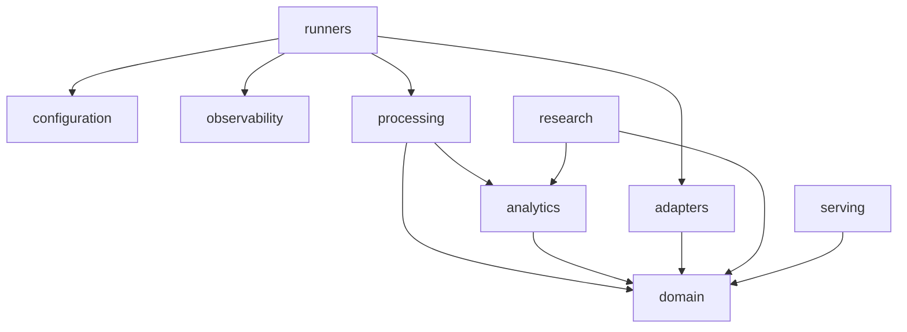

# LABGDD V2 architecture

Status: Phase 0, bounded Bronze, canonical Silver and individual-company Gold are
approved for their recorded scopes. Phase 2 Milestone 5 adds a separate bounded
expected-series Gold publication without modifying earlier immutable evidence
or implementing sector analytics. See PHASE1_INGESTION.md, PHASE2_BATCH.md, PHASE2_GOLD.md,
RESEARCH_UNIVERSE.md and PHASE2_EXPECTED_SERIES_SPARK.md.
Baseline: `phase0-approved-v1` / `81be7794ffa4c197e866f3fc89d147287abb3731`.
Reviewed: 2026-11-04. Bar schema is v1.0.0; measurements are v2.0.0.
The calendar adapter and local acquisition are tested with mocked provider input.
Correction resolution and live finalization remain designs, not runtime services.

## Scope and evidence

This is an independent greenfield foundation. The only pre-existing workspace file
was `docs/reference/PROJECT_AUDIT_AND_REBUILD_CONTEXT.md`. It remains unchanged;
SHA-256: `553d34b93258fe35bd061956b616f30c72e3c8759419a4cfd849920d071eb069`.
The audit was read as historical evidence, including its temporal, correction,
security and recovery findings. No legacy source, credentials, data, environments,
services or experiment artifacts were accessed or imported.

## Dependency direction

Arrows mean imports, not data flow. Domain uses only the Python standard library
and has no I/O. Analytics owns pure formulas. Processing owns execution plans,
quality projection and window orchestration; it does not redefine estimators.
Adapters own external transport, codecs and persistence. Introduce a narrow
interface only when an actual adapter consumer needs substitution. Runners wire
components and handle exit codes, never financial rules. Configuration and logging
are application facilities outside domain.

Current code includes domain, project/historical/Silver/Gold/research configuration,
observability, REST/calendar/Bronze/Silver/Gold adapters, acquisition/Spark Batch
orchestration, individual-company analytics, research-universe references, an
optional expected-authority Spark projection and thin runners. Serving remains a
documented boundary. Tests include mocked acquisition, persistence, Spark parity,
expected-series calendar/membership fixtures and absent-population left joins.
No network, filesystem writes, logging configuration or services occur at import.
`validate_return_window` is a small domain eligibility check over caller-supplied
UTC session bounds: H+1 consecutive closes for H returns, with no calendar lookup,
sorting, correction resolution or implicit gap filling. Individual-company formula
code and independent Spark parity are implemented; sector formulas remain deferred.

## Intended data flow (future phases)

Alpaca REST -> immutable Bronze page observations -> Spark Batch -> Silver -> Gold.
Alpaca WebSocket -> retained Kafka observations -> Structured Streaming -> the same
Silver/Gold contracts. Replay uses the same input snapshot, revision resolution,
membership, calendar and finalization cutoff as Batch. Bronze is authoritative
observation evidence; Kafka retention is a replay buffer, not the sole archive.
Parquet layers are governed files with manifests, not a transactional lakehouse.
PostgreSQL is optional serving of finalized Gold, not a competing source of truth.
Power BI consumes published facts. No component places trades.

## Configuration and execution identity

Python 3.11, TOML via `tomllib`, explicit file paths, no implicit `.env` loading.
The CLI defaults to `config/project.toml`, resolved relative to the caller;
storage paths resolve relative to that file's parent and must stay within the
project's dedicated `data/` directory (beside `config/`). Unknown keys fail.
Universe membership is variable-sized. The bounded `study-cohort-v1` reference
preserves 30 symbols/six project groups with explicit declared applicability and
unverified historical evidence. Expected symbol/session rows come from this
reference plus requested XNYS sessions, never observed market-data availability.
Secrets come only from the process environment in future acquisition adapters.
The template is documentation, not a shell script. Phase 0 needs no credentials.
Each CLI execution generates a UUID, emits JSON with UTC timestamps, and reports
only allowlisted event fields. Configuration errors report field names, not values.
`allowed_lateness_minutes` is a nonnegative integer, default 10; settings expose it
without applying any finalization in Phase 0. Future runners record it with the
snapshot cutoff. An event-time watermark estimates progress, not completeness;
idle required inputs keep live windows provisional. Explicit bounded completion
can finalize a named snapshot, not certify all market observations are present.

Run manifests must record run UUID, code commit plus dirty-tree
hash, Python and locked environment fingerprint, full nonsecret configuration,
input/output hashes, schema/measurement/calendar/membership versions, feed,
adjustment, as-of cutoff and completion status. Publish the completion manifest
last after atomic same-filesystem staging/rename; partial work stays uncommitted.
Run IDs and query checkpoints must share one owned namespace. No overwrite of
completed experiments or cross-query exactly-once claim without a commit protocol.
Completed Silver directories are not authoritative by discovery order. Downstream
selection requires an explicit dataset/run identity resolved through the checked-in
publication registry with verified status and fingerprints.
Gold registry v1.1 retains explicit selection while supporting more than one
independently approved dataset and Gold schema. The embedded publication status is
historical creation metadata; registry approval is the external selection authority.

## Testing and reproducibility

Use an isolated `.venv`, exact locked development/build dependencies and no runtime
dependencies. Python is constrained to the 3.11 minor series; record the exact
patch in `.python-version`. Lock scope and regeneration are in ADR 002.
Ruff formats/lints, mypy checks strict typing, pytest checks contracts, temporal
edge cases, configuration and safe logging. A dependency guard checks that domain
imports only the standard library. Install and smoke-test a wheel in a second clean
environment outside the source tree. CI runs the same checks on Windows and Linux.
Future engine parity compares exact keys/nulls/counts and finite float values with
`abs(a-b) <= 1e-12 + 1e-10*abs(b)`; no tolerance for missing/extra output rows.

## Legacy reference and data preservation

No migration is automatic. A separately reviewed import would inventory immutable
legacy artifacts read-only, hash files, preserve their original schemas and
measurement meanings, and register them in a distinct external dataset manifest.
Never relabel intrabar dispersion as close-to-close RV. Revalidation/conversion
produces new dataset versions under V2-owned paths with lineage back to originals.
Do not deserialize old model binaries during inventory. Historical partial
experiments remain historical evidence, not completed V2 experiments.

## Open decisions and risks

- Research sector labels are a study taxonomy, not verified historical industry
  classifications. The initial mapping is a static cohort; effective dates and
  corporate actions require evidence before historical sector claims.
- ADR 005 selects pinned `exchange_calendars`/XNYS for the common regular-session
  grid; listing applicability still requires independent evidence. Raw IEX prices
  and same-session returns are confirmed initial research policies.
- IEX is a partial venue, not consolidated market coverage. Entitlements and
  historical/live comparability need an authenticated Phase 1 probe.
- Source corrections may lack globally ordered revisions. Ambiguous conflicts
  must be quarantined rather than resolved using arrival time or price ordering.
- Configurable lateness (default ten minutes), calendar provenance, atomic manifest
  publication and detection-rule calibration still require operational/scientific
  validation in their respective phases. Idle inputs never finalize by silence.
- Spark 4.3/Python 3.11/Java 21/PyArrow 21 is pinned and verified for non-root
  Linux `local[2]` batch execution. Multi-node Spark, distributed filesystems,
  Kafka connectors and object-store publication remain unselected and unverified.
- Thirty selected companies introduce selection/survivorship bias. Correlation
  and co-elevation do not establish causality or trading profitability.
