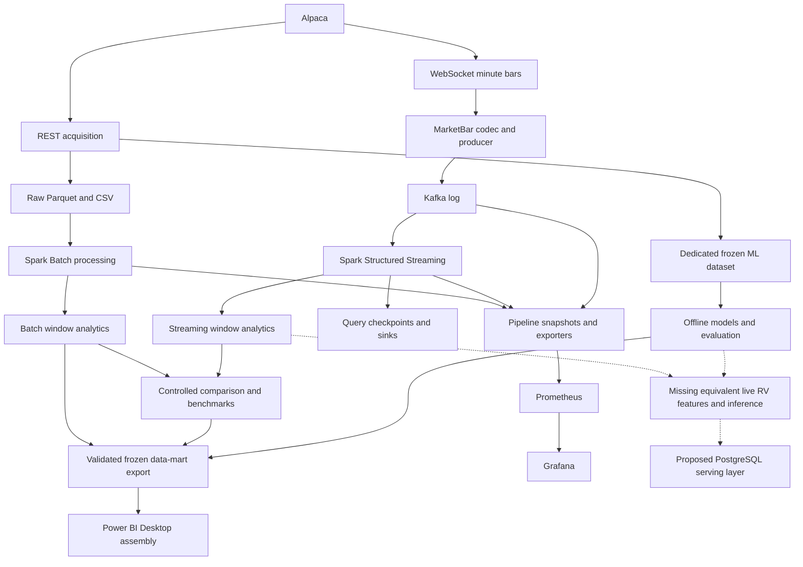
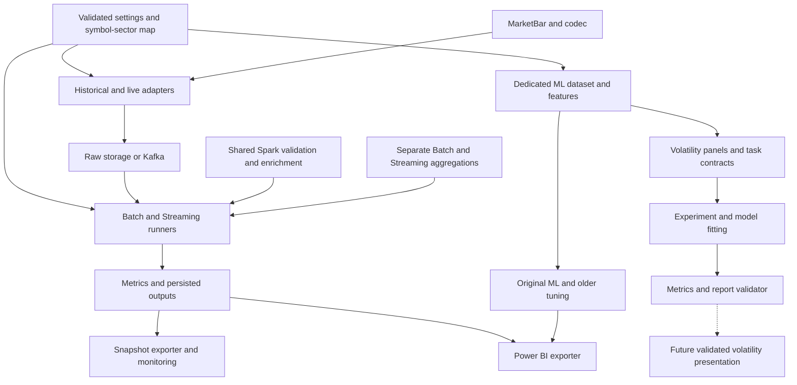
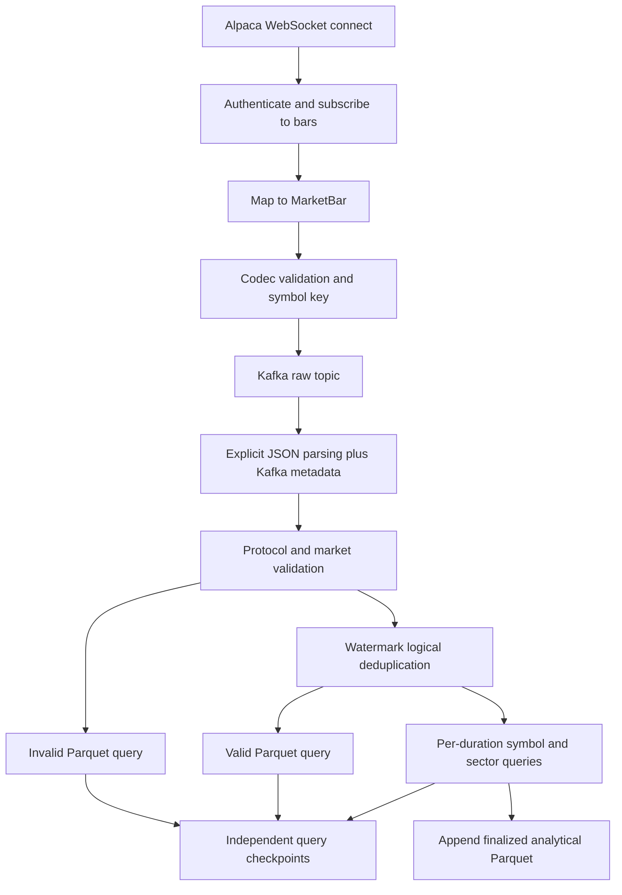
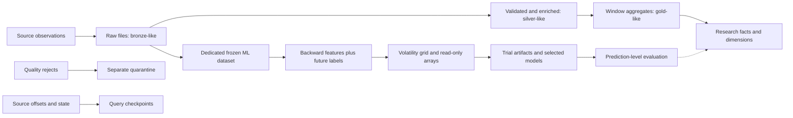
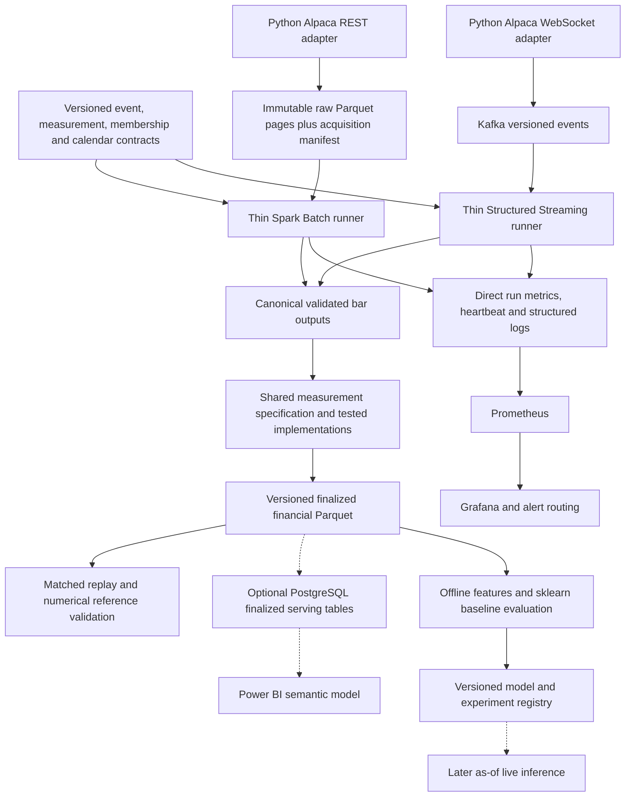

# Complete Project Audit and Technical Knowledge Transfer

**Project:** Big Data Pipeline for the Analysis of Emergent Sector Volatility in Financial Markets: Batch and Streaming  
**Audit date:** 2 November 2026; artifact/process inspection snapshot approximately 19:51 UTC, Europe/Lisbon.  
**Repository revision:** `223ec8fa` (`main`), plus existing working-tree changes and local artifacts.  
**Scope:** Read-only audit. The only repository output created by this audit is this file. No application code, configuration, credentials, datasets, services or training processes were modified. No tests, ingestion, exports, benchmarks, containers or rebuilds were run.

## Evidence notation and inspection limits

- **[VC] Verified in code:** directly inspected implementation/configuration; not a claim of successful runtime execution.
- **[VA] Verified in local artifact:** inspected persisted metadata, Parquet footer, log, manifest or historical test result. This supplements the requested evidence categories.
- **[FD] Found in documentation:** an existing README/report claim, distinguishable from fresh verification.
- **[IA] Inferred from architecture:** a reasoned consequence of inspected code; not a reproduced failure unless explicitly stated.
- **[NV] Not verified:** insufficient evidence or deliberately outside read-only scope.
- **[RN] Recommended for the new implementation:** a proposal, not something already deployed.

The audit catalogued and structurally parsed **77 Python source files** and **25 test modules**, traced critical execution paths, inspected infrastructure/configuration, the notebook, historical reports, manifests and representative saved results, and inspected ML Parquet row counts/schemas through file metadata. Static parsing is not execution. Large price tables were not exhaustively rescanned, binary models were not deserialized, and all historical checksums were not recomputed. Test coverage percentages, current API entitlements, live Kafka/Spark/monitoring health and a finished Power BI report were not established. Existing credentials were never printed or copied into this report. Recommendations do not authorize remediation during this audit.

## 1. Executive Summary

**[VC]** This is a substantial local research implementation, not an empty draft. It contains historical Alpaca REST acquisition, a WebSocket-to-Kafka path, Spark Batch and Structured Streaming, symbol/sector financial analytics, controlled equivalence/performance experiments, offline classical/neural ML, Prometheus/Grafana configuration, and a validated-file Power BI exporter. Most code is organized by concern, and several immutable experimental outputs and validation utilities are worth preserving.

**[VA]** The processed ML Parquet footer contains **2,276,418 observations**, and the original feature table contains **2,001,858 rows**. A stored controlled comparison reports matching original analytics at five window sizes. Historical performance and classification/regression artifacts exist. The newer volatility experiment is incomplete: inspection found **662 saved fit results**, an active supervised worker, and no final V3 manifest. Counts are time-specific, not a completion percentage.

**[IA]** The current system only partially answers the full sector-volatility research question. The original Batch/Streaming analytics are comparable for their declared intrabar-return dispersion, but the new close-to-close realized-volatility, dependence, breadth and emergence pipeline is offline NumPy/pandas research. There is no equivalent deployed streaming RV feature/inference path. Demonstrating original analytical equivalence does not close this gap.

**Priority findings:**

1. **[VC/VA] Critical security exposure:** `.env` is tracked by Git. The expected Alpaca credential variables have non-empty values that do not look like placeholders. Their validity was not tested. Treat them as potentially exposed; no values are reproduced here.
2. **[VC/IA] High consistency risk:** validation, conflicting-duplicate selection, unknown-symbol handling and historical time-window semantics differ across ingestion/processing implementations.
3. **[VC/VA] High reliability risk:** long local ML runs have suffered native Python crashes; resume is restricted to pre-final-selection work, and trial completion is not committed as one coherent transaction.
4. **[VC/IA] High observability limitation:** the exporter primarily re-presents persisted snapshots. It can serve stale query status or zeros for missing fields without proving runtime health.
5. **[VC] Rebuild blockers for generalization:** absolute-path/evidence-mtime coupling, fixed five-company sectors, fixed output roots and hardcoded Power BI prediction counts.

**[RN]** Preserve the current experiments as evidence. Build a second implementation around canonical event/measurement contracts and adversarial replay tests first, then share deterministic computations between bounded and incremental runners. Add serving storage and ML only after that foundation is correct. Do not restart the project by replacing every component or increasing model complexity.

## 2. Research Objective and Scope

The target research question is:

> How can emergent sector volatility across the stocks of multiple companies be analyzed scalably and reproducibly by integrating historical batch and real-time streaming OHLCV data with sufficient quality and temporal consistency for comparable results?

**[VC/FD]** The application distinguishes individual price movements from coordinated sector risk. Its newer monitoring variables cover intensity, constituent breadth, dependence and concentration. Returns remain secondary tasks. Correlation does not demonstrate causal contagion, and forecast accuracy does not demonstrate trading profitability.

**[VC]** `config/config.yaml` defines a fixed, project-specific universe:

| Sector | Symbols |
|---|---|
| Technology | AAPL, MSFT, NVDA, GOOGL, AMD |
| Healthcare | JNJ, PFE, LLY, MRK, ABBV |
| Defense | LMT, NOC, GD, RTX, HII |
| Aerospace | BA, TDG, HEI, TXT, GE |
| Energy | XOM, CVX, COP, SLB, OXY |
| Financial | JPM, BAC, GS, MS, V |

These are configured research groups, not a verified dynamic industrial-classification or historical-membership service. There are five constituents per group. The active feed is IEX. The current application does not place orders, operate an autonomous trading agent, or perform online learning. A configured paper-trading base URL is not an implementation of paper trading.

**[IA]** Four distinct scientific claims need separate evidence: output equivalence; processing trade-offs; baseline-relative prediction; and reliable sector-event detection. None substitutes for another. The existing sample is manageable locally; distributed technologies are an architectural/scalability research choice rather than a demonstrated necessity for these row counts.

## 3. Current Implementation Status

| Capability | Evidence and status | Boundary |
|---|---|---|
| Historical acquisition | [VC] `AlpacaClient`, `MarketDataIngestionService`, raw storage; [VA] historical datasets | No live API request performed; generic REST retry/rate-limit handling absent |
| WebSocket ingestion and Kafka producer | [VC] authentication/subscription, reconnect logic, codec and delivery handling; [VA] test/live smoke JSONs | Minute bars only; corrections/quotes/trades not integrated |
| Kafka infrastructure | [VC] Compose, topic administration and symbol keys | Current broker health not verified; one broker, replication one |
| Spark Batch | [VC] quality checks, deduplication, features and persistence; [VA] benchmark outputs | Local execution; some feature windows count observations rather than minutes |
| Structured Streaming | [VC] explicit schema, metadata checks, watermark state and sinks; [VA] deterministic/restart/late-data artifacts | Current service health not verified; no global transaction across queries |
| Original window analytics | [VC] Batch and Streaming implementations; [VA] controlled comparison PASS | Original estimand differs from new RV |
| Comparative experiments | [VC] workload/replay, comparison and repeated measurement harnesses; [VA] Phase 7/8 reports | Local controlled replay, not production traffic or cluster scaling |
| Monitoring | [VC] exporter, Prometheus scrape jobs and Grafana provisioning; [VA] historical runtime PASS | Snapshot freshness and crash detection limited; current endpoints not probed |
| Frozen direction/return ML | [VC] trainers/validators; [VA] Phase 10/11 artifacts | Offline research, limited neural epochs/populations in older experiments |
| Older tuning | [VC] `src/ml/tuning/` and `run_phase13.py`; [VA] partial `.work` artifacts | Do not confuse with newer volatility search or assume a completed Phase 13 freeze |
| Volatility/emergence research | [VC] target construction, selection, tests, evaluation/reporting code; [VA] saved fits | Ongoing; no final V3 manifest at audit snapshot |
| Power BI | [VC] validated export and documented model/DAX/pages; [VA] data-mart manifest | Desktop assembly not independently verified; no automatic finished PBIX claimed |
| PostgreSQL | [NV] no configured application integration identified | Proposed future component only |
| Flink/Hadoop MapReduce/RabbitMQ/Redis Streams/Isolation Forest | [NV] no implementation/dependency identified | External alternatives, not current stack |
| Production orchestration/HA/live ML | [NV] not implemented end to end | Local helper supervision is not a production scheduler |

**[VA] Runtime snapshot:** Python supervisor PID `28088` and worker PID `28580` were present with matching command lines during inspection. This does not establish continued health after the snapshot. No broker, Spark or dashboard is described as currently running merely because Compose declares it.

## 4. Repository Structure

### 4.1 Meaningful directory tree

```text
config/config.yaml                      universe, source, paths and runtime settings
src/
  main.py                               historical ingestion CLI
  config/settings.py                    typed settings and validation loaders
  models/market_bar.py                   immutable MarketBar dataclass
  processing/normalization.py            pandas source normalization/validation
  ingestion/                            REST adapter and per-symbol coordination
  storage/parquet_storage.py             raw local Parquet/CSV persistence
  kafka/                                event codec, producer, topics, transport demos
  streaming/                            Alpaca WebSocket, live CLI, source metrics
  spark/                                Batch/Streaming engines and window analytics
  metrics/                              Batch, analytics and query metric records
  equivalence/                          controlled workload, replay and comparator
  performance/                          repeated runs, sampling and summary statistics
  ml/                                   datasets, original features/targets, frozen ML
    tuning/                             older classification/return searches
    volatility/                         newer RV/regime/emergence experiment
  monitoring/exporter.py                 persisted-metric collector and HTTP server
  powerbi/export.py                      frozen-evidence dimensional export
scripts/                                raw/Batch/Streaming output validators
tests/                                  25 test modules, 125 test function definitions
notebooks/01_data_exploration.ipynb       one Markdown placeholder cell
monitoring/                             Prometheus/Grafana provisioning and dashboard
datasets/manifests/                     engineering dataset registration
datasets/ml/ml_dataset_v1/               frozen ML raw/processed/features and metadata
data/raw/, processed/, analytics/        operational historical/streaming files
data/checkpoints/, checkpoints/          query state and isolated experimental state
data/powerbi/                           regenerable CSV/Parquet facts/dimensions
models/classification/, regression/     original and hardened/frozen results
models/tuning/, research/               partial/ongoing historical research versions
benchmarks/                             preserved JSON/CSV measurement artifacts
reports/                                analyses, figures, paper aids and local helpers
Dockerfile.spark, Dockerfile.monitoring, docker-compose.yml
requirements.txt, .gitignore, README.md
.env                                    tracked sensitive local settings; do not copy
```

**[VC/VA]** `LABGDD_Entrega1.docx`, `arch.png`, generated architecture figures and IEEE materials are documentation, not running services. `reports/figures/architecture/build_diagrams.py` generates publication assets and a Word copy; it requires optional `python-docx`, which is not declared in the application requirements. The notebook is not an implemented exploratory workflow. Historical report-local power/supervision scripts are operational aids, not reusable domain modules.

### 4.2 Entry points and interactions

Commands below document intended entry points; **none was executed as part of this audit**.

| Entry point (`python -m ...`) | Interaction |
|---|---|
| `src.main` | `load_settings` -> `AlpacaClient` -> `MarketDataIngestionService.run` -> normalize/validate -> `ParquetStorage.save_raw_bars` |
| `src.kafka.create_topics` | Load broker/topic settings -> administer raw/DLQ topics |
| `src.kafka.demo_producer`, `demo_consumer` | Independent codec/key/delivery diagnostics; not production financial analytics |
| `src.streaming.realtime_ingestion` | Load source/broker settings -> async WebSocket client -> synchronous producer callbacks -> final source metrics |
| `src.spark.batch_processor` | Discover raw Parquet -> `transform_batch` -> processed/quarantine -> pipeline metrics |
| `src.spark.batch_analytics` | Read processed Batch -> source/session preparation -> symbol/sector window outputs -> analytics metrics |
| `src.spark.structured_streaming_processor` | Kafka source -> shared quality logic -> independent valid/invalid/window queries -> checkpoints/sinks/metrics |
| `src.equivalence.controlled_dataset`, `src.equivalence.phase7` | Generate/replay controlled bars, run bounded analytics and compare matched outputs |
| `src.performance.benchmark`, `batch_worker` | Isolate runs/topics/paths; invoke jobs; sample resources and normalize measurements |
| `src.ml.dataset`, `src.ml.prepare` | Dedicated immutable ML acquisition and feature/label/split construction |
| `src.ml.run_phase10` | Train original classifiers then harden/freeze evidence through the classification workflow |
| `src.ml.run_phase11` | Independent return-regression experiment with frozen statistical/financial evaluation |
| `src.ml.run_phase13`, `src.ml.tuning.run_*` | Older bounded validation searches and final TEST evaluation |
| `src.ml.run_phase14` | New company/sector RV, regimes and emergence experiment via `Experiment.run` |
| `src.ml.validate_frozen`, `validate_regression`, `tuning.validate` | Reload/check saved experiment evidence; these are executable validation tools, not proof they passed today |
| `src.monitoring.exporter` | Discover snapshots -> `PipelineCollector.collect` -> Prometheus HTTP endpoint |
| `src.powerbi.export` | Read fixed frozen inputs -> dimensions/facts -> validate -> publish files/manifest |

**[VC]** Shared utilities include `ConfigurationError`, typed settings dataclasses, the immutable `MarketBar` data holder, codec field validation, Spark OHLCV validation and sector enrichment, JSON metrics dataclasses, SHA-256 utilities, and temporal/sequence helpers. The dataclass alone does not enforce bar validity. Different pipelines still reimplement validation and formulas.

**[VC/IA] Duplication/legacy:** `src/spark/transformations.py`, `src/ml/features.py` and the volatility panel builder all construct related but non-identical historical features. `streaming_analytics.py` and `batch_analytics.py` duplicate window aggregations. `src/ml/tuning/` and `src/ml/volatility/` are separate experiment frameworks. Original classification financial metrics remain in `evaluation.financial_metrics` although hardened metrics supersede their aggregate interpretation. Preserve these versions as evidence, but do not make them competing production authorities. `AlpacaClient.get_multiple_stock_bars`/`health_check` are convenience methods rather than required steps in the main service. Demo tools are useful diagnostics, not automatically dead code.

**[VA] Git chronology:** commits include transport/processing evolution, `9b4c571c` performance work, `a39500f7` monitoring, `8347322d` classification, `0e425bf3` regression, `c4fbcca8` BI, `358821c8` older tuning, `7bac3ded` volatility pipeline and `223ec8fa` architecture/IEEE documentation. Commit subjects describe intent, not execution proof. Local `models/tuning/phase13_independent_v2` and partial `.work` directories are not evidence that the current `run_phase13.py` represents every historical independent-run implementation.

## 5. Reconstructed Architecture

### 5.1 Overall system

**[VC]** Solid relationships below are implemented data/dependency paths; dashed boxes/arrows are missing integrations.



**[IA]** This is best described as dual-path processing plus offline research. It is not a fully deployed Lambda serving/reconciliation architecture, a pure Kappa-only stream system, a lakehouse or a real-time ML platform. Spark window output is not automatically the input representation required by the NumPy neural models.

### 5.2 Component dependencies



**[VC]** Cross-layer imports are practical but reveal coupling: Streaming imports filesystem helpers from `batch_processor`; Batch analytics imports session/return utilities from `streaming_analytics`; volatility imports the original 37-feature catalogue; BI imports fixed frozen artifact formats. The second implementation should expose stable domain, time, storage and measurement packages instead of treating runner modules as utility libraries.

**[VC/IA] Comparator boundary:** `src/equivalence/phase7.py::_rows` returns an empty list for a missing directory; `_compare_rows` indexes rows into dictionaries without rejecting duplicate keys. Comparing two missing/empty output roots can therefore produce no missing or mismatched keys and a false PASS, while duplicate analytical rows can be collapsed during comparison. This is a static failure-mode finding, not a claim that the stored Phase 7 campaign used empty inputs. Require expected nonzero keys/counts and uniqueness before numerical comparison.

## 6. Batch Pipeline Analysis


### 6.1 REST acquisition

**[VC]** `src/ingestion/alpaca_client.py::AlpacaClient` uses `requests.Session`, API-key/secret headers, a 30-second default request timeout and configured base URL `https://data.alpaca.markets/v2`. `get_historical_bars` calls `/stocks/{symbol}/bars` with start/end/timeframe/limit/feed, follows `next_page_token`, and accumulates all pages in memory. `get_multiple_stock_bars` loops sequentially rather than issuing a multi-symbol endpoint request. `_get` validates success and JSON shape and wraps request failures in `AlpacaApiError`.

**[VC]** There is no implemented 429 `Retry-After` handling, bounded exponential REST retry, checkpointed pagination or repeated-token guard. A failed page fails that symbol's acquisition. `MarketDataIngestionService.run` catches API/quality/OS errors per symbol, logs the failure and continues; unexpected pandas conversion errors are not all covered by that exception tuple. The dedicated ML dataset builder instead aborts the build on a failed symbol. Neither should be described as unlimited robust acquisition.

**[VC]** `normalize_bars` maps Alpaca `t,o,h,l,c,v`, adds the requested symbol, parses UTC, casts numeric columns and sorts. `validate_market_bars` checks required/null/sorted data, some negative values and high >= low; it does not fully match codec/Spark checks for finite prices, OHLC bounds and integer volume. Naive timestamps can be assigned UTC by pandas rather than explicitly rejected as timezone-less input.

### 6.2 Raw storage and corrections

**[VC]** `ParquetStorage.save_raw_bars` writes under `data/raw/<SYMBOL>/<start>_<end>_<timeframe>.{parquet,csv}`. It merges an existing same-name file, keeps its last duplicate, and removes incoming keys already present in other files. This prevents overlap duplication but **does not update a corrected bar already stored under a different range filename**. Writes are direct rather than one atomic multi-format transaction; concurrent symbol writers are not coordinated. Source revision/feed identity is not part of the logical key.

### 6.3 Spark processing

**[VC]** `batch_processor.discover_parquet_files` searches symbol directories; `prepare_raw_data` casts an explicit logical schema; `transform_batch` adds sectors, calls shared Spark validation, deterministically deduplicates and computes features. Invalid rows and duplicate extras are quarantined. Unknown symbols receive `Unknown` and can remain accepted, unlike the Streaming path. Volume is cast to long before validation, so a fractional source volume can be truncated rather than rejected on integer-ness.

**[VC]** `transformations.deduplicate_records` orders conflicting duplicates by OHLCV values and retains rank one. This is deterministic but not a source-correction/version policy. `add_financial_features` partitions by symbol only; returns can span overnight/session boundaries, and 5/15/30 observation moving averages are not exact elapsed-minute windows.

**[VC]** `run_batch` caches/counts several DataFrames, writes processed symbol partitions, and persists metrics. The normal writer overwrites full or selected partitions. The Windows PyArrow fallback materializes each symbol with `toPandas`, removes its existing partition, then writes it; its memory/durability properties differ from distributed Spark persistence. `_windows_native_hadoop_available` checks for `winutils.exe`, although the Streaming error message requires both it and `hadoop.dll`; that availability probe is incomplete.

**[VC/IA]** Batch window analytics duplicate much of Streaming's formulas and reuse session/bar-return helpers. This is useful for controlled comparison but creates drift risk. Selected-symbol overwrites also require a clearly bounded input universe; otherwise recomputing a partial history could replace a partition expected to represent a larger history. Output-root deletion/safety helpers must be redesigned for owned run directories, not reused casually in a shared lake.

## 7. Streaming Pipeline Analysis



### 7.1 Source adapter and delivery

**[VC]** `AlpacaWebSocketClient` connects to configured IEX endpoint `wss://stream.data.alpaca.markets/v2/iex`; the test endpoint is `/v2/test` with `FAKEPACA`. It expects connected/authenticated control messages, sends credentials in an auth frame and subscribes to minute `bars`. `market_bar_from_message` processes `T=b` and maps `S,t,o,h,l,c,v`. It does not implement updated/corrected bars, trades or quotes.

**[VC]** Bounded `max_queue=64`, connection/ping timeouts and exponential reconnect with jitter are configured. Error codes `{401,402,405,406,409,410}` are terminal; other control errors reconnect. The consecutive reconnect counter resets after successful subscription; malformed frames/bars are counted/skipped. Subscription confirmation checks for a subscription message, not a full equality check of requested versus granted symbol membership. `MarketBarProducer.publish` is synchronous inside the source callback; queue/backpressure behavior is not a separate durable source spool. `_process_frame` does not explicitly handle every producer-buffer exhaustion condition.

**[VC]** `run_realtime_ingestion` flushes producer delivery on shutdown and persists final source metrics. `events_published` increments after enqueueing, not after an individual broker acknowledgement; delivery failure is checked separately. It is not an exact acknowledgement counter. Credentials are loaded by settings, not embedded in emitted bars.

### 7.2 Kafka contract

**[VC]** The local broker is Kafka 4.3.1 in combined KRaft broker/controller mode. Topics `market-bars-raw` and `market-bars-dlq` have six partitions and replication factor one. Producer configuration enables idempotence, uses all configured acknowledgements and gzip compression. Symbol is the record key; headers declare event type and schema version. Partition ordering does not establish global event-time ordering.

**[VC]** `demo_consumer` is a bounded diagnostic consumer with explicit offset commits; it is not the financial processor. `create_topics` supports repeat administration. No application producer publishes rejected Spark records to the provisioned DLQ. No transactional Kafka-to-multiple-sink commit protocol, retention-aware recovery guarantee or multi-broker failover is demonstrated.

### 7.3 Spark parsing and state

**[VC]** `read_kafka_stream` sets bootstrap/topic, starting offsets, data-loss behavior, maximum offsets and header inclusion. `parse_kafka_market_bars` preserves record key/header/topic/partition/offset/Kafka timestamp, parses the explicit payload schema and captures corrupt records. `validate_and_enrich_stream` checks schema version and key/payload agreement, shared OHLCV conditions and unknown symbols. The emitted `event_type` header is not independently validated by those protocol checks.

**[VC]** `deduplicate_valid_stream` uses `withWatermark(...).dropDuplicatesWithinWatermark([symbol,timestamp])`. The configured watermark is ten minutes. Conflicting duplicate payloads are subject to arrival/state behavior, not Batch's OHLCV ordering. `processing_time` records Spark time separately from source `timestamp` and `kafka_timestamp`. Source timing is not a measured ingestion timestamp, and Kafka time is not market time.

**[VC]** Continuous defaults are a five-second micro-batch trigger and maximum 10,000 offsets per trigger. Two sink queries plus two analytical levels at five durations yield **12 independent queries** in the full configuration. Each has separate source progress/state/checkpoint identity and may repeat parsing/deduplication work. The implementation deliberately separates duration queries to avoid an observed available-now union-finalization problem; this is a local design decision, not proof that all Spark multi-query plans require it.

### 7.4 Filesystem commit and restart

**[VC]** `_write_micro_batch` writes a temporary directory and renames it to `batch_id=<20-digit ID>`, skipping an existing committed batch. `_replace_directory_with_retry` handles transient permission locks. Same-checkpoint restart restores offsets and deduplication/window state; starting offsets apply only to a new checkpoint identity.

**[IA]** Checkpoint and output identities must be coupled. Reusing an output directory with a fresh checkpoint can reuse batch IDs and skip different data. Query-local rename/idempotency does not make valid, invalid and all analytical sinks one global exactly-once transaction. Empty output batches may advance offsets without a directory, and late-data completeness depends on event-time progress. Quiet sources do not guarantee window finalization; controlled experiments inject a clearly excluded closing sentinel.

## 8. Dataset and Storage

### 8.1 Verified dataset inventory

| Dataset/artifact | Inspected evidence | Population and caveat |
|---|---|---|
| Engineering `v1` | [VA] `datasets/manifests/dataset_v1.json` | 113,988 rows; 30 symbols/six sectors; 2026-09-01 through 2026-09-18, configured end 09-20; no regular-session-only flag. Count is manifest-reported, not freshly scanned |
| Frozen `ml_dataset_v1` | [VA] manifest plus `processed/market_bars.parquet` footer | 2,276,418 rows; observed 2025-10-01 13:30 UTC through 2026-10-01 19:59 UTC; regular session only |
| Original `features_v1` | [VA] metadata plus Parquet footer | 2,001,858 rows, 37 features; warm-up exclusions; future labels may still be missing by horizon |
| Volatility prepared grid | [VA] V2 `data/schema.json` | 98,280 grid rows per entity; company 2,948,400 and sector 589,680 rows. Grid rows include missing observations and are not extra acquired bars |
| Controlled Phase 7/8 datasets | [VC/VA] generators and benchmark files | Synthetic deterministic logical events; populations differ from the 30-stock ML sample |
| BI data mart | [VA] `data/powerbi/manifest.json` | 18 tables; 161,840 symbol windows, 40,316 sector windows; each frozen prediction fact reports 2,957,096 rows |

**[VA]** The stored ML quality report records 252 trading dates, 671,982 missing expected symbol-minutes, zero duplicate identities, zero reported null fields/OHLC violations and zero zero-volume rows. These are historical quality-gate outputs, not newly recomputed findings. `quality_report` assumes 390 minutes per observed symbol-day and does not integrate an exchange holiday/early-close calendar; that missing-minute statistic is therefore a nominal-grid measure. Fully absent symbol-days can also be omitted from its per-symbol observed-day denominator.

### 8.2 Schemas and persistence

**[VA]** Processed ML Parquet: `timestamp` is microsecond timestamp with UTC timezone; symbol/sector/trading date are strings; OHLC are float64; volume is int64. The original features add numerical indicators, exact-horizon future close/return fields, categorical direction labels and a chronological split. Spark Parquet timestamps and PyArrow fallback timezone metadata require care: `_spark_schema_to_arrow` writes microsecond timestamps without carrying the same explicit timezone declaration as the dedicated ML table.

**[VC]** Raw storage partitions by directory/symbol and acquisition range. Batch processed files use Hive-style symbol partitions. Streaming uses immutable batch directories with symbol partitions for valid rows; analytical roots also separate duration and level. ML tables are versioned files rather than a distributed feature store. Volatility panels use read-only NumPy memmaps with companion entity/time/split metadata and JSON schema. V3 references the verified V2 cache rather than duplicating it. Its absolute `data_reference.json` source must remain available.



**[IA]** Raw/processed/analytics approximate Bronze/Silver/Gold responsibilities, but there is no formal medallion contract, transaction log, schema registry or catalog. Checkpoints are recovery state, not a data-quality layer. Do not introduce lakehouse branding without implementing its guarantees.

**[VC/IA]** `.gitignore` excludes many large datasets, model files, NumPy predictions and checkpoints. Git carries selected evidence, not everything required to resume or reproduce a run. Some current research directories and machine helpers remain untracked. Metadata and hashes alone cannot reconstruct missing source observations or deleted intermediate models. Backups need explicit artifact inventories and relocatable references.

## 9. Financial Analytics

In the table, `P` is close, `O` open, `r` log return, `R` simple return, `H` horizon, and `N` fixed constituent count. **[VC]** identifies implementation; validation references identify existing tests, not tests rerun here.

| Calculation | Formula/algorithm, input and window | Implementation/output | Assumptions, checks and issues |
|---|---|---|---|
| Simple historical return | `(P_t-P_previous)/P_previous` for positive previous close | `spark/transformations.add_financial_features`: `return_pct` | Previous observation by symbol, including gaps/overnight; `test_spark_batch.py` checks basic formulas |
| Historical log return | `ln(P_t/P_previous)` for positive prices | Same function: `log_return`; analogous pandas features | Same observation/time ambiguity; ML feature histories reset per symbol/date |
| Observation-count indicators | 5/15/30-row SMA; 30-return sample SD | Same function: `ma_*`, `rolling_volatility_30` | Not exact minute windows; full counts needed; no session reset in general Batch |
| ML return and momentum features | Close ratios to 1/5/15/30 prior observations; five-step price difference | `ml/features.engineer_features` | Same-session groups; missing bars change elapsed horizon even where names say minutes |
| EMA and MACD | EWM spans 5/15/30; EMA12-EMA26, signal EWM9, histogram difference | `ml/features.py` feature table | Backward-only; span initialization and warm-up affect coverage |
| ATR | Rolling 14-row average of max(high-low, abs(high-prior close), abs(low-prior close)) | `engineer_features::atr_14` | Session reset; sample-count rather than exact clock convention |
| RSI | EWM average gain/loss with alpha 1/14; `100-100/(1+gain/loss)` | `rsi_14` | Positive-gain/zero-loss -> 100; completely flat cases can stay missing and be dropped |
| Bollinger features | Rolling 20 mean +/- twice sample SD; bandwidth divided by middle | `bollinger_upper/lower/bandwidth` | Not a separately validated strategy |
| Volume features | Relative volume to 30-row mean; ratio change in ML | `features.py` | General Spark `volume_change` is an absolute difference, unlike the ML ratio change; same name, different formula |
| Time/context | Local hour, minute of day, minutes since open; sector mean/SD of current returns and deviation | `features.py`, volatility grid | Time bins support intraday analysis; no separate deployed intraday-pattern model. Current-bar data only available after arrival |
| Original bar return | `(close-open)/open` if open > 0 | `streaming_analytics.add_bar_return`, reused by Batch source prep | Not close-to-close return |
| Original window return | `(last close-first close)/first close` in fixed half-open windows | `build_symbol_analytics`, `build_batch_symbol_analytics` | First/last use event time; single-bar return is zero, not the bar's close/open return |
| Original window volatility | Sample SD of bar returns; pooled at sector level | Batch/Streaming symbol/sector builders | A one-observation sample SD is null. Pooled constituent SD is not portfolio volatility |
| Price/volume summaries | Mean/min/max close, first/last close for symbols, summed volume, count | Same builders, Parquet analytical tables | Sector pooled mean price is descriptive across differently priced assets, not a sector index |
| Coverage | Symbol count/H; sector count/(H * observed active symbols) | Same builders; `_analytics_coverage_summary` | Sector count uses approximate distinct active symbols; a wholly missing constituent may not reduce the reported ratio. Not fixed-universe completeness |
| Company realized volatility | `sqrt(sum(k=1..H) r_(t+k)^2)` | `volatility/data.realized_paths`, `rv.npy` | Exact full H+1 prices, same session; 1/5/15/30/60 analytics and 5/15/30 targets; no filling or annualization |
| Sector realized volatility | `sqrt(mean_i(RV_i^2))` | `sector_components`, `sector/rv.npy` | All five configured constituent paths required; not covariance-inclusive portfolio risk |
| RV dispersion | Mean, median, population SD across constituent RV | `sector_components`, analytics Parquet | Requires valid fixed membership; missingness retained |
| Concentration | `w_i=RV_i^2/sum_j RV_j^2`; HHI `sum_i w_i^2`, top-one/top-two shares | `sector_components` and stored components | Zero total variance produces undefined shares; no causal meaning |
| Broadness | `(1-HHI)/(1-1/N)` | `data.prepare` summary tables | Defined relative to fixed N; N=5 currently enforced |
| Intra-sector dependence | Pairwise Pearson correlation over synchronized H-minute log-return windows; mean signed/absolute correlation and valid-pair count | `sector_components` | Implemented only H>=3; undefined/constant-return pairs remain missing. Different valid-pair sets affect interpretation |
| Inter-sector dependence | Sector mean constituent log return, rolling Pearson pairs at 5/15/30/60; daily mean signed/absolute correlations and valid counts | `data.prepare`, `inter_sector_correlation.csv` | Offline descriptive association; no causality, directed spillover network or live equivalent |
| Synchronization proxy | Fraction of members above per-member training high-RV thresholds | `data.prepare`: `high_fraction`, alias `synchronization_ratio` | Co-elevation proxy, not independent proof of synchronized shocks |
| Volatility regimes | Per-entity training 1/3 and 2/3 RV quantiles; LOW below, HIGH above, otherwise NORMAL | `targets.Contract.values` | Fold-specific thresholds; equal thresholds flagged; classes need not balance out of sample |
| Emergence | High sector RV AND strict majority high members AND correlation > max(0,train high quantile) AND HHI <= train high quantile | `targets.Contract` future-window label | Exploratory project rule, not externally validated crisis taxonomy; quiet windows can remain valid despite unused undefined correlation |
| Return targets | `P_(t+H)/P_t - 1`, exact endpoint; class boundaries +/-0.0005 inclusive neutral | `ml/targets.py`, return contracts | Endpoint return need not have every intermediate minute; distinguish from complete-path RV |

**[VC]** `tests/test_batch_analytics.py`, `test_streaming_analytics.py`, `test_ml_features.py` and `test_ml_volatility.py` cover many formula, missingness, session, threshold and concentration cases. **[NV]** No fresh full-data numerical audit, complete new RV Batch/Streaming equivalence or external economic-event validation was performed here.

**[VC/IA]** There are multiple volatility/time definitions and two different volume-change definitions. These are not necessarily wrong for their original purpose, but reusing the same name across systems is unsafe. A new measurement catalogue must state estimator, sampling clock, missingness/session convention, membership policy, units and version.

## 10. Machine Learning

### 10.1 Data preparation and leakage controls

**[VC]** `ml/dataset.build_dataset` acquires a dedicated immutable one-year dataset; it is not just a Spark benchmark output. `ml/prepare.prepare` engineers 37 features, adds exact future labels, removes incomplete warm-up rows, assigns chronological splits and reports training-only threshold analysis. `ml/targets.add_future_targets` joins exact symbol/date/timestamp endpoints. `ml/sequences.build_sequences` and `tuning/common.build_sequences_fast` enforce contiguous one-minute, same-symbol/session histories.

**[VA]** Original splits are 176 training dates through 2026-06-12, 38 validation dates 2026-06-15–08-07, and 38 TEST dates 2026-08-10–10-01. This TEST was inspected in earlier work. **[IA]** Preserving it during current selection is necessary but cannot restore pristine out-of-sample status after repeated research.

**[VC]** The new panel builder adds five past-RV fields, observation/60-minute coverage fields and five sector-context fields, for **49** features. It restores observed raw values where original derived-feature warm-up excluded rows, preserves gaps on a 390-slot/day grid, and uses train-fitted feature imputation. Target data are never imputed. Session calendars remain nominal rather than a validated early-close service. Historical feature construction is backward-only, but some return predictors labelled as minute horizons still count observed rows.

### 10.2 Model generations and persisted evidence

| Generation | Actual models/settings and objective | Persistence/evaluation |
|---|---|---|
| Original classification | `train_classification.train`: majority, logistic, forest, LSTM/GRU; direction at 5/15/30m. Initial neural ceiling four epochs; 60-bar lookback and caps | Original output under `phase10_classification_v1`; hardening produces `phase10_classification_final_v1` |
| Frozen return regression | `run_phase11.run`: zero/train mean, OLS, forest regressor, LSTM/GRU; original 37 predictors and 60-step histories | Separate feature/target scalers, full/common populations, row predictions, models, histories, figures, checksums |
| Older tuning | `run_phase13` calls classification and regression modules in `ml/tuning`; candidate enumeration, validation selection, trial CSVs and work directories | A partial `.phase13_classification_tuned_v1.work` is present; completion must be checked per manifest. Older neural budgets differ from newer 75-epoch research |
| Volatility research | `volatility/targets.TASKS`: seven tasks. Four classifier families or five regressors per task/horizon, totaling 93 jobs | Versioned research roots; params, fold/seed results, predictions/indices, final-gate and independent population audit code |

**[VC]** Forests/logistic/Ridge use scikit-learn; LSTM/GRU use TensorFlow/Keras/AdamW. The new search varies architecture, learning rate, dropout, lookback, batch, hidden size, layers, weight decay, patience and class weighting where relevant; forest size/depth/split/leaf/features/bootstrap/subsampling/class weights; logistic C/penalty/compatible solver/weights; and Ridge alpha. OLS has one specification. Forest/logistic/Ridge have no epoch concept.

**[VC]** New neural training uses a 75-epoch ceiling, primary-validation early stopping and best-checkpoint reload. Selection monitors Macro F1, positive-event F1 or original-unit MAE according to task, not training loss alone. `preprocess` computes train-only medians and batched scaler moments; sequence batches are generated on demand; tabular fitting uses a temporary disk-backed matrix and chunked predictions. Forest memory checks reject oversized candidates rather than shrink their population.

### 10.3 Selection and limitations

**[VC]** `Experiment.context` constructs fold-specific contracts and masks TEST labels from training/selection. Three expanding folds end validation on 07-02, 07-22 and 08-07. `optimize` completes three-fold references, screens additional candidates on fold zero, promotes two candidates, then uses three-fold mean and a one-standard-error near-tie preference for lower complexity. Seeds 42/43/44 for a leading neural family and feature-family ablations are implemented as subsequent stages, not proven complete at the audit snapshot.

**[IA]** A subtle promotion issue remains: `optimize` sorts `aggregates` containing reference means over three folds alongside candidates with only fold-zero scores. Those promotion scores are not the same estimand. Final winners still require three folds, but promising candidates can be filtered using an inconsistent screen. Rebuild screening to compare the same fold set before promotion. Also, validation both controls epochs and ranks candidates, so selection optimism remains; three folds are not a significance test.

**[VC]** Tuning limits are 240,000 tabular training rows, 60,000 neural endpoints and 20,000 validation endpoints. Common 120-bar eligibility aligns tuning validation keys, not training sample sizes. The declared final policy uses all eligible original-training rows, all eligible validation rows for epoch choice, and all eligible TEST rows, with separate common-key metrics. `reporting.validate_results` independently reconstructs row populations and checks saved targets/probabilities/metrics/epochs. These safeguards are valuable; a present implementation is not evidence that final audits have run.

**[VC/IA] Finalization boundary:** `reporting.validate_results` validates the evaluation records supplied to it but does not require all 93 planned combinations or reject an empty evaluation list. `finalize` records omissions and can assign `validated_full_final_population` to a partial set. That status describes population checks on supplied results, not necessarily a complete campaign. Inspect planned/selected/evaluated/omitted counts together; the new implementation should separate validity status from completion status.

### 10.4 What is operational

**[VA]** Offline fitting is operational in the limited sense that saved models/predictions exist for older experiments and a matching V3 worker was active at the snapshot. V3 had 662 saved fit files and no final manifest. **[NV]** No deployed stream inference service, model registry endpoint, online adaptation or model-driven trading is established.

**[VA/FD]** Frozen Phase 10 reports Random Forest full-test Macro F1 of 0.3844/0.3448/0.3288 at 5/15/30m and no consistent recurrent advantage. Frozen Phase 11 generally fails zero return on common keys. The separate fixed Phase 14 interim review reports reference sector-RV MAE improvement around 15–19% over persistence, but weak/unstable emergence F1. These are different targets, populations and evaluation periods, not one comparable leaderboard. The audit did not rederive these metrics from all predictions.

**[VC]** Inference exists as batch prediction/reload functions (`volatility/models.inference`, frozen validators and trainers), not an HTTP/gRPC/live inference integration. Financial diagnostics apply only to declared return policies; volatility/emergence has no defined trading policy. Earlier signal-level compounding is retained in old code and superseded by hardened timestamp-level portfolio diagnostics. New `volatility/metrics.financial` additionally handles day/gap liquidation. None is a full executable execution-cost backtest.

### 10.5 Reproducibility and interruption

**[VC/VA]** Native Python failure `0xC0000005` with faulting module `python311.dll` is recorded in `reports/phase14_crash_diagnosis.json`; the specific responsible library is unknown. The local `reports/phase14_supervisor.py` enables faulthandler, records exit events and allows bounded preselection native-crash retries. It is an untracked Windows-specific mitigation, not proof of root-cause repair or reboot survival.

**[VC/IA]** `models.fit` writes `result.json` before `Experiment.trial` augments it with job identity, contract, validation indices and baseline/sector evidence. A crash in between can leave a syntactically valid but logically incomplete result that breaks strict resume. Resume also requires identical absolute settings, shared-cache hashes and preserved-evidence inventory including mtimes; it refuses after final selection begins. Long final-fit/evaluation stages therefore lack general restart safety. Preserve the existing results, but rebuild experiment state as explicit atomic stage commits with schema/version/integrity checks.

## 11. Infrastructure and Dependencies

**[VC]** The host stack is Python with requests, pandas/PyArrow, PyYAML/dotenv, confluent-kafka, websockets, PySpark, psutil, matplotlib, prometheus-client, scikit-learn/joblib and tensorflow-cpu. `requirements.txt` pins PySpark 4.0.1 but otherwise uses version ranges. It is not a lockfile and does not specify Python's exact patch release, native numerical libraries or an optional document-generation environment.

| Service/runtime | Actual configuration | Limitation |
|---|---|---|
| Kafka | `apache/kafka:4.3.1`; host 9092, internal `kafka:29092`; six partitions; named `kafka-data` | Single combined node and replication one; plaintext listeners; no application HA claim |
| Spark container | `spark:4.0.1-scala2.13-java21-python3-ubuntu`; added pinned pandas/PyArrow/dotenv/YAML; `/workspace` bind mount | Default command sleeps indefinitely; jobs launched separately; `local[*]`, not a multi-worker cluster |
| Pipeline exporter | Python 3.11 slim, prometheus-client pinned; port 8000; repository read-only mount | Entire repository still readable, including tracked `.env`; freshness not guaranteed |
| Kafka exporter | Versioned exporter container, port 9308 | Configured endpoint does not establish current scrape success |
| cAdvisor | Privileged host/container observation, port 8080 | Broad host mounts/privilege; Docker Desktop visibility caveats |
| Prometheus | Versioned image, port 9090; five-second scrapes/evaluation; named data volume | No configured rule files or Alertmanager routing identified |
| Grafana | Versioned image, port 3000; datasource/dashboard provisioned; named volume | Insecure development fallback credentials exist; values omitted here |
| Offline ML | Host CPU, two intra-op/OMP threads and one inter-op in newer runner; forest jobs two | Limited RAM/native Windows reliability; no verified GPU acceleration |
| PostgreSQL/SQL serving | No application dependency, driver, container, schema or migration identified | A host SQL service or a helper stopping SQL services is not project database integration |

**[VC] Intended startup:** create the host environment, supply credentials to ingestion, start broker/container infrastructure, administer topics, launch source ingestion and the Spark job, then observe persisted outputs. Host clients use localhost listeners; container clients require internal broker addressing/CLI override. BI export reads existing frozen evidence without ingestion/training. Compose does not schedule the whole workflow or automatically start a Spark processing application.

**[IA]** A full-stack `docker compose up` can consume substantial resources even when only ML is needed. Use optional profiles in the rebuild. No resource limits, full dependency lock, dedicated ML image, migration system, scheduler, credential isolation or backup workflow is demonstrated. `tools/` and document/service helpers should not become accidental production infrastructure.

**[VC] Security discrepancy:** settings call `load_dotenv`; `.env` is tracked and `.gitignore` only covers `.env.*`, not the bare file. `git ls-files -- .env` confirms tracking. Both expected credential assignments are non-empty and non-placeholder-looking; actual validity and repository visibility were not tested. Whole-repository mounts into Spark/exporter and the absence of `.dockerignore` broaden potential exposure. The documentation's “no credentials mounted in monitoring” assertion is not supported by this mount layout. No secret was included in the audit output and no credential action was performed.

## 12. Monitoring and Visualization

**[VC]** `metrics/pipeline_metrics.py`, `batch_analytics_metrics.py`, `streaming_query_metrics.py` and `streaming/metrics.py` define persisted run measurements. `StructuredStreamingMetrics` records output batches, source offsets, progress durations, event-time watermark, state operators, invalid/duplicate/late/drop counts, symbols, sectors and analytical coverage. `run_structured_streaming` saves an initial running snapshot and its final snapshot; callback accumulation alone does not continuously publish all in-memory progress to disk.

**[VC]** `monitoring/exporter.discover_metric_files` recursively searches selected filename patterns, excludes output/checkpoint trees and picks newest matching files by mtime/kind. `PipelineCollector` exposes exporter health, query active/failed flags, rates, counts, state/watermark, selected latency/lag and Batch throughput metrics. It uses Gauge families even for names ending `_total`; run resets/latest-file switching do not have monotonic-counter semantics. Missing/unparseable numbers often become zero.

**[IA]** A stale “running” JSON can outlive a dead worker, and a zero can mean missing evidence rather than measured zero. There is no strong run identity, age alarm or heartbeat-to-process linkage in the main exporter. The separate local ML supervisor status is not wired into that Grafana data source. Exporter-up means the exporter served a scrape, not that ingestion or computation is healthy.

**[VC/VA]** Prometheus scrape config and a Grafana datasource/dashboard exist; `reports/phase9_runtime_validation.json` records historical PASS. Early `phase9_observability_analytics.json` contains an empty run; the later V2 artifacts document a populated controlled validation. These are different historical runs, not interchangeable proof. Current endpoint health was not checked during this audit. Grafana is operational presentation; Power BI is scientific/financial presentation.

**[VC/VA]** `powerbi/export.py` creates six dimensions (date, symbol, sector, task-scoped model, horizon, dataset) and financial/classification/regression/comparison/performance/equivalence facts. Its manifest reports 18 tables, keys/schema/count/checksum validation and two 2,957,096-row prediction facts. DAX, relationships and twelve dashboard-page specifications are documented under `reports/POWERBI_*`. There is no verified automated Desktop PBIX generation. The current exporter points to original frozen experiments and Batch V1 finance, not a general latest-stream or Phase 14 connector.

**[VC/IA]** Export paths, model lists and expected prediction counts are hardcoded. `export` builds a temporary directory, then removes the previous output before renaming, leaving a failure window; this is weaker than an atomic replacement of a versioned catalog pointer. `_validate` covers many useful keys/references but should not be represented as a general all-table/all-FK proof. Raw financial data, window analytics and frozen model results are available for visualization; a validated full new emergence dashboard is not established.

## 13. Testing and Code Quality

### 13.1 Test and validation inventory

**[VC]** Static discovery found 125 test function definitions across 25 modules; parametrization may generate more cases. This is not an executed pass count or a coverage percentage.

| Group | Test modules / reliable evidence | Coverage intent and limitation |
|---|---|---|
| REST/source/domain | `test_alpaca_client`, `test_market_data_ingestion`, `test_normalization` | Pagination/auth/error/quality and per-symbol isolation; no complete REST resilience policy |
| Live source/Kafka | `test_alpaca_websocket`, `test_realtime_ingestion`, `test_kafka_event_codec`, `test_kafka_producer` | Protocol, reconnect, codecs, key/delivery behavior, flush; mocks are not live end-to-end proof |
| Spark/financial analytics | `test_spark_batch`, `test_spark_streaming`, `test_batch_analytics`, `test_streaming_analytics`, `test_streaming_metrics` | Plans/formulas/session/missingness; import/runtime skips can hide unavailable Spark environments |
| Storage/config | `test_parquet_storage`, `test_settings` | File overlap behavior, configuration and universe expectations |
| Controlled experiments | `test_phase7_equivalence`, `test_phase8_performance` | Deterministic records, comparison/statistics/path isolation; runtime result artifacts remain separate |
| Original ML | `test_ml_dataset`, `test_ml_features`, `test_ml_evaluation`, `test_ml_hardening`, `test_ml_regression` | Temporal/feature/target/scaler/probability/diagnostic contracts; local binary-artifact tests may skip |
| Search/new volatility | `test_ml_tuning`, `test_ml_volatility` | Deterministic candidates, eligible populations, thresholds, checkpoint restore, resume, full-population rejection tests |
| Monitoring/BI | `test_monitoring`, `test_powerbi_export` | Snapshot selection, metric/config parsing, export keys/FKs/evidence; some tests skip absent local outputs |

**[VA] Historical test evidence:** `phase14_full_population_tests.xml` records 53 tests, zero failures/errors and two skips on 2026-10-27; `phase14_sampler_tests.xml` records 20 tests with zero failures/errors/skips; `phase14_validation_stopping_tests.xml` records 46 tests with two skips. They describe earlier collected suites and source versions. A later conversation-recorded run reported 28 passes, but that is not a newly generated audit test report. These differing counts must not be combined into one current-suite pass claim.

**[VC]** Scripts `validate_raw_data.py`, `validate_batch_output.py`, `validate_streaming_output.py` and ML validators check output schemas, identities, sectors, target samples, probabilities, metrics and artifacts. The initial notebook is a placeholder. No CI workflow, coverage report or static type-check configuration was identified in the inspected repository.

### 13.2 Code-quality assessment

- **[VC] Strengths:** clear ingestion/storage/config boundaries; settings dataclasses; dependency injection in WebSocket/HTTP/producer tests; explicit timezones; independent quarantine; model-specific manifests; readable focused financial tests; chronological control; exact target joins; prior-evidence preservation.
- **[VC/IA] Maintainability costs:** phase-numbered scripts and fixed paths act as architectural APIs; runners import one another's private filesystem helpers; validation/formula duplication spans pandas/Spark/codec; several experimental files compress many operations onto long lines; model tasks/results rely on mutable ad-hoc dictionaries rather than validated schemas.
- **[VC/IA] Error handling:** REST handles basic transport failures but not rate-limit retries; Streaming catches broad failures to finalize metrics; model experiments turn some fit errors into recorded omissions. Broad catches keep research progressing but require explicit completeness gates. Native crashes bypass Python exception handling.
- **[IA] Test gaps:** cross-engine conflicting corrections, entirely missing sector members/days, fractional-volume casts, stale-run health, crash between result writes, checkpoint/output mismatch, same-path concurrent ingestion and interruption after frozen selection deserve targeted tests. A “no future feature” test is not equivalent to live feature availability with delayed constituents.

## 14. Technical Debt and Risks

Severity follows the request: **Critical** blocks safe/correct operation; **High** is serious reliability/consistency debt; **Medium** limits reuse/scale/maintenance; **Low** is cleanup. Some findings describe conditional failure modes rather than reproduced invalid results. Nothing below was fixed during this audit.

| ID / severity | Description and evidence | Potential impact | Recommendation and rebuild disposition |
|---|---|---|---|
| S1 **Critical** | [VC/VA] Tracked `.env`, credential-variable assignments non-empty/non-placeholder-looking; bare `.env` not ignored | Potential secret disclosure through current/history copies; live validity unknown | [RN] Treat as potentially compromised; verify/revoke/rotate with owner, remove tracking/history exposure through an agreed procedure, retain only redacted template. **Fix before sharing/deploying** |
| S2 **High** | [VC] Whole repo mounted into exporter/Spark; no `.dockerignore`; monitoring docs claim no mounted credentials | Read-only does not prevent secret reading; unnecessary build/runtime exposure | [RN] Narrow mounts/build contexts and supply per-service secrets. **Redesign boundaries** |
| C1 **High** | [VC] pandas validator weaker than codec/Spark; Batch accepts Unknown while stream rejects it; volume casts precede integer validation | Same source rows can receive different quality status | [RN] Canonical rules/error codes with adapters and fixtures. **Refactor shared contract** |
| C2 **High** | [VC] Raw same-file keep-last, cross-file ignore-existing, Batch OHLCV-ordered rank, Streaming within-watermark arrival policy | Conflicting duplicate/corrected values can differ between paths | [RN] Explicit source revision, deterministic correction/tie policy and matched replay tests. **Rebuild dedup policy** |
| C3 **High** | [VC] Original volatility is intrabar SD; new RV/dependence/emergence exists offline only | Claimed research integration can outrun actual live implementation | [RN] One estimator specification and live equivalent state/feature tests. **Add missing integration** |
| R1 **High** | [VA] Recorded native Python access violation and prior run interruptions; library root cause unknown | Lost incomplete fits, long silent downtime, unreliable ETA | [RN] Preserve dumps/faulthandler/exit evidence, isolate execution environment and fit processes, bounded scheduler retries. **Redesign execution** |
| R2 **High** | [VC/IA] `models.fit` writes result before `Experiment.trial` adds required identity/indices/evidence | Crash can leave an apparently complete file that fails strict resume | [RN] Staged artifacts plus one validated completion manifest published last. **Fix/rebuild trial commit** |
| R3 **High** | [VC] Preselection-only resume; exact absolute paths and evidence mtimes required | Relocation/late-stage interruption can strand expensive work | [RN] Content-addressed portable data refs and idempotent per-stage resume while freezing selection. **Rebuild state model** |
| O1 **High** | [VC/IA] Exporter picks latest file, initial/final query snapshots, missing fields -> zero | Stale health/zero observations can masquerade as fresh operational state | [RN] Run identity, heartbeat/freshness, missing-vs-zero semantics, real metrics listener and alerts. **Refactor** |
| T1 **High** | [VC/IA] `optimize` promotion compares three-fold reference means with one-fold candidate scores | Biased candidate promotion, though final selection still requires three folds | [RN] Match screening fold sets then promote; test that rule. **Fix methodology before new campaign** |
| T2 **High** | [VC/IA] Phase 7 comparator accepts two empty/missing roots as matching and dictionary-indexes away duplicate keys | A future campaign can report PASS without meaningful complete output | [RN] Assert expected nonempty outputs, multiplicity, uniqueness and counts before values. **Fix comparator preconditions** |
| C4 **Medium** | [VC] Observation-count lags named minute returns; Batch history spans sessions, ML resets | Gapped/asynchronous intervals can be compared as equal-minute observations | [RN] Explicit clock/gap/session metadata and shared exact-grid feature definitions. **Refactor/rebuild features** |
| C5 **Medium** | [VC] Coverage uses observed/approximate active symbols; nominal 390-minute calendars | Entire missing members/days and early closes distort completeness | [RN] Exchange calendar and fixed-universe denominator with observed/expected counts. **Rebuild completeness** |
| R4 **Medium** | [VC] REST accumulates all pages and has no retry/backoff or resume token checkpoint | Fragility at longer histories/API limits; redundant downloads | [RN] Bounded retry, Retry-After, incremental persistent pages and acquisition manifest. **Refactor adapter** |
| R5 **Medium** | [VC/IA] Checkpoint reset with existing sink batch IDs; separate sink commits | Silent skips or inconsistent cross-output state if identities are mismanaged | [RN] Owned run namespaces, checkpoint/output manifest pairing, failure-injection tests. **Refactor sink protocol** |
| P1 **Medium** | [VC] Multiple independent analytical queries; driver `collect`/`toPandas` fallbacks; broad caching | Repeated computation, small-file growth and driver/RAM limits | [RN] Preserve correct baseline, measure consolidation and bounded writers before optimizing. **Refactor based on measurements** |
| P2 **Medium** | [VC] Fixed-five-member arrays and mutable config-derived universe | Adding members or changing mapping can break target shape or silently change interpretation | [RN] Version membership, validate against dataset contract and support ragged/entity-indexed groups. **Rebuild membership abstraction** |
| B1 **Medium** | [VC] BI input/model lists and expected counts hardcoded; old directory deleted before replacement | New datasets fail validation; refresh may lose previous output on rename failure | [RN] Discover contract-driven inputs; version exports and atomically publish a pointer. **Refactor exporter** |
| M2 **Medium** | [VC/IA] Final validator checks supplied evaluations rather than campaign completeness; manifest status can accompany omissions | Valid partial evaluations can be misread as all requested models completed | [RN] Separate integrity/population validity from completion; require expected coverage or explicitly acknowledged omissions. **Refactor finalization** |
| M1 **Medium** | [VC/FD] Repeated historical TEST use; validation also tunes epochs/params; scarce emergence labels | Overoptimistic inference and unstable apparent winners | [RN] Later evaluation period, nested/rolling assessment, uncertainty/episode support reporting. **Redesign experimental protocol** |
| S3 **Medium** | [VC] Plaintext local broker, exposed host ports, default dashboard credentials and privileged cAdvisor | Acceptable only within a bounded trusted dev setup; unsafe to extrapolate | [RN] Profiles, restricted binds, explicit credentials, least privilege and production-specific security plan. **Redesign if exposed** |
| E1 **Medium** | [VC] Wide host dependency ranges, different container pins, Windows-specific helpers | Reproduction and binary compatibility failures; unknown crash provenance | [RN] Lock host/container environments and separate data/ML/docs extras; record image/runtime hashes. **Refactor packaging** |
| F1 **Medium** | [VC] Legacy signal-level compounding and newer diagnostic variants coexist | Downstream users can select obsolete financial interpretation | [RN] Freeze old evidence; one versioned diagnostic API with cost/day/gap conventions. **Retire live use of old function** |
| D1 **Low** | [VC/FD] Phase-numbered documentation, empty notebook and stale claims in monitoring docs | Handover confusion; confusing planned BI with implemented export | [RN] Keep historical reports dated, create current capability map, archive placeholders. **Documentation cleanup** |

**[NV]** The audit did not prove that all original numeric results are invalid, identify the native crash's root library, establish actual credential abuse, or demonstrate corruption of the saved datasets. Those would require additional investigations. Recommendations must not be interpreted as findings of events not observed.

## 15. Technology Selection Assessment

The following combines **[VC] repository use**, official-source facts, and **[RN] design judgments**. No alternative was benchmarked here; migration performance estimates would be preliminary. Linked current documentation is conceptual guidance, not certification of compatibility with the repository's older pinned runtime.

| Choice | Assessment for this project |
|---|---|
| Spark vs Flink vs MapReduce | Spark is already implemented and can express bounded and incremental DataFrame transformations; retain it while fixing contracts. Flink is a legitimate stateful bounded/unbounded alternative if measured latency/state needs justify migration, not an assumed universal improvement. MapReduce is suitable for bounded map/reduce jobs but would not replace the continuous path without another engine. [Spark guide](https://spark.apache.org/docs/latest/streaming/apis-on-dataframes-and-datasets.html), [Flink architecture](https://flink.apache.org/what-is-flink/flink-architecture/), [MapReduce tutorial](https://hadoop.apache.org/docs/stable/hadoop-mapreduce-client/hadoop-mapreduce-client-core/MapReduceTutorial.html) |
| Kafka vs RabbitMQ vs Redis Streams | Kafka fits the existing retained partition log/replay and Spark integration. RabbitMQ includes retained streams and must not be dismissed as queue-only; Redis Streams offers append-style streams and consumer groups. Choice requires retention, recovery, throughput and operating-cost requirements, not technology popularity. No replacement benchmark exists. [Kafka design](https://kafka.apache.org/41/design/design/), [RabbitMQ Streams](https://www.rabbitmq.com/docs/streams), [Redis Streams](https://redis.io/docs/latest/develop/data-types/streams/) |
| Parquet vs CSV vs JSON | Keep JSON for versioned events/config/compact metrics, Parquet for typed analytical scans, CSV for compact exchange/inspection. CSV/JSON are not schema/recovery systems; Parquet alone does not provide multi-table transactions. [Parquet overview](https://parquet.apache.org/docs/overview/) |
| Files vs PostgreSQL | Keep immutable historical Parquet as research truth; optionally use PostgreSQL for run metadata, indexed finalized windows/events and BI serving. Partitioning/indices need workload-specific design; do not load every raw/repeated prediction into PostgreSQL merely to use a database. It is absent today. [PostgreSQL partitioning](https://www.postgresql.org/docs/current/ddl-partitioning.html) |
| Classical/neural ML vs statistical baselines | Keep persistence, zero return, regularized linear models and forest. Add target-compatible HAR-RV/GARCH comparisons before superiority claims. Neural models require measured incremental benefit and compute accounting; current sector results do not establish universal advantage |
| Isolation Forest | Potential unsupervised anomaly-score baseline, absent today. Its anomaly objective is different from forecasting future RV or the project's supervised emergence label; scores require calibrated thresholds and matching time/label evaluation. Do not call an anomalous isolated company a sector event automatically. [IsolationForest API](https://scikit-learn.org/stable/modules/generated/sklearn.ensemble.IsolationForest.html) |
| Existing monitoring vs direct instrumentation | Keep Prometheus/Grafana infrastructure; replace stale snapshot health with properly scoped current instrumentation and age-aware historical snapshots. These complement logs and scientific metrics; they do not prove correctness |
| BI choices | Existing Power BI dimensional export is reusable. Add PostgreSQL as an optional serving interface if refresh/concurrency requires it. Keep Grafana operational; no need to duplicate financial dashboards there |

**[RN]** A simple pandas/NumPy or SQL reference implementation should remain the numerical oracle for small fixtures and resource-cost comparison. “Big Data” relevance comes from the processing problem and measured scaling, not the presence of several containers.

## 16. Keep / Refactor / Rebuild / Remove / Add

All dispositions below are **[RN]**; nothing was removed or rebuilt during this audit.

| Decision | Modules/artifacts | Reason and migration condition |
|---|---|---|
| **KEEP** | `MarketBar` shape; explicit versioned codec concepts; `KafkaDeliveryError`; injected WebSocket/HTTP test seams | Useful boundaries with strong fixtures; retain strict validation semantics, then extend source/revision metadata |
| **KEEP** | Configured universe as a versioned research fixture; immutable manifests/checksums | Preserve original experiments; do not silently reinterpret historic membership |
| **KEEP** | Exact future target joins, session-contained RV construction and missingness-preserving tests | Strong numerical/temporal foundation; port behind a measurement contract and independently cross-check |
| **KEEP** | Controlled workloads, sentinel rationale, numerical comparator, performance statistics and isolated-run design | Reuse as acceptance harness; add duplicate-key validation and adversarial correction cases |
| **KEEP** | Frozen Phase 10/11 results and negative findings, row-level predictions and hardening reports | Avoid losing scientific evidence or reusing historical TEST as pristine |
| **KEEP** | Power BI dimensions/task-scoped model IDs, data-mart validation concepts, Grafana provisioning | Useful presentation/operations separation; not a reason to preserve hardcoded counts |
| **REFACTOR** | `AlpacaClient`, `MarketDataIngestionService`, `ParquetStorage` | Retries/pagination checkpointing, unified validity, atomic immutable raw pages and explicit correction handling |
| **REFACTOR** | Settings loaders and code-level path handling | Preserve dataclass validation; add a single project/run context, deployment profiles and secret isolation |
| **REFACTOR** | Batch/Streaming runners and filesystem writers | Keep orchestration adapters thin; move shared policy/storage helpers out of runner-private functions |
| **REFACTOR** | Feature libraries and financial diagnostics | Preserve tested formulas under explicit versions; eliminate ambiguous names and session clocks |
| **REFACTOR** | Exporter and BI builders | Heartbeat/freshness/run identity; schema-driven discovered datasets; versioned export publication |
| **REBUILD** | Canonical dedup/correction/time-completeness policy | Current paths make materially different decisions; this is a domain-contract redesign |
| **REBUILD** | Experiment stage/commit/resume registry | Multi-write completion, absolute paths and late-stage restart restrictions cannot support reliable long campaigns |
| **REBUILD** | Sector synchronization/emergence live integration | Offline code is useful numerical reference, but equivalent incremental state and as-of availability must be designed/tested |
| **REMOVE from new runtime** | Old signal compounding path, placeholder notebook, redundant phase-specific orchestration entry points | Archive as history, not competing maintained interfaces. Preserve genuine smoke/diagnostic tools |
| **REMOVE from tracked/shared context** | Secrets and machine-local power/service scripts | Security and portability; preserve only redacted templates/runbook concepts after approved remediation |
| **ADD** | Exchange calendar, data-contract schema tests, source-revision identity, ownership manifests | Required to establish quality/temporal comparability |
| **ADD later** | PostgreSQL serving adapter/migrations, baseline anomaly model, standardized model interface and optional inference | Add when questions/consumer workload justify them; not every component on day one |
| **ADD** | Environment locks, CI with explicit skip policy, crash/failure injection, artifact retention/backup | Make reproduction and interruption behavior verifiable |

## 17. Proposed Improved Architecture

### 17.1 Target design

Everything in this subsection is **[RN]** unless marked reused. The intended stack can be kept without launching every service initially.



“Shared measurement” does not require the exact same Python function to run unchanged inside NumPy and Spark. It requires one declared algorithm, clock, membership and missingness policy with identical golden fixtures, plus carefully tested engine implementations. First implement deterministic finalized-window metrics; only then consider incremental provisional results and revisions.

### 17.2 Proposed package and contract boundaries

```text
domain/        event/quality/error/measurement/membership schemas; no I/O
adapters/      Alpaca REST/WebSocket, Kafka, Parquet, optional PostgreSQL
processing/    pure transforms, event-time policy, shared window specifications
runners/       batch, stream, replay and acquisition orchestration
analytics/     RV, dependence, concentration, breadth and emergence definitions
research/      datasets, folds, baselines, model interfaces, experiment state
observability/ structured logs, run heartbeats, Prometheus collectors
serving/       optional finalized-window/event publication and BI views
contracts/     schemas and golden fixtures, semantic versions and migration notes
deployment/    Compose profiles, locks, secure examples and storage ownership
tests/         pure, adapter, engine-parity, fault-injection and acceptance suites
```

**[RN] Event contract:** preserve source event time and separate receive time; record feed, timeframe, source, schema version and immutable payload identity; normalize UTC; make original versus corrected revisions explicit. Do not assume a price timestamp alone orders revisions. Reference sector membership/calendar by version/effective date rather than copying a mutable current mapping into old evidence.

**[RN] Layers:** Bronze records acquisition/replay provenance and source revisions; Silver represents normalized policy-resolved bars with explicit quality and session fields; Gold contains window keys, estimator version, expected/observed constituents/minutes, finalization/revision status and lineage. Quarantine has stable reasons and source references. All layer manifests identify run, code/environment and input fingerprints.

**[RN] PostgreSQL, when needed:** use migrations and explicit keys for runs, quality summaries, finalized symbol/sector windows, alerts and model versions. A window key should include dataset/feed, membership/measurement version, entity, duration and bounds. Use transactional upserts only under a defined revision/finalization policy; store immutable large histories/predictions in Parquet and reference them. Avoid creating an unexplained second source of truth.

**[RN] Experiments:** independently commit input eligibility, fold contract, fit, checkpoint, predictions, metric audit and frozen selection. A completion record is published last. Resume verifies content and stage identities, not incidental mtimes or machine paths. Retries must not silently change candidate/data populations; post-selection recovery must not retune on TEST. Record native process exits and distinguish experiment failure from valid early stopping.

## 18. Scientific Gaps and Validation Requirements

| Research requirement | Existing support | Required additional evidence |
|---|---|---|
| Original analytical equivalence | [VA] Phase 7 report: PASS, ten level/window comparisons, zero missing/mismatched rows, tolerance `1e-10` | [RN] Independently rerun on clean inputs and include conflicting revisions, unknown symbols and all-missing constituents |
| Local processing trade-offs | [VA/FD] Phase 8 reports 24 runs: 10k/25k/50k/100k events, two paths, three repeats | [RN] Explicit warm-up/timing policy, saturation/backlog response, steady-state live tests and resource-sampling completeness |
| New volatility temporal consistency | [VC] Offline RV and future-window contracts/tests | [RN] Golden Batch/Streaming new-RV/dependence/membership outputs at the same event-time cutoffs and under late arrivals |
| Scalable sector monitoring | [VC] Local components and controlled smaller-universe experiments | [RN] Increasing assets/dates/events, skew/state size, memory, checkpoint growth, sustained lag and recovery measurements; no cluster extrapolation |
| Useful RV prediction | [VA/FD] Positive interim baseline-relative validation | [RN] Final selected/common/full-population holdout, HAR-RV/GARCH, per-sector distributions, later unseen period and uncertainty |
| Useful emergence detection | [VC] Explicit exploratory label, window and episode metrics | [RN] Enough independent episodes, sensitivity/ablation, false alarms per full observed timeline, precision/recall and operational latency |
| Cross-company/sector coordination | [VC] Pairwise correlation, breadth, HHI/top shares and inter-sector summaries | [RN] Fixed membership/coverage comparisons, within-vs-between-sector context, robustness to constant series and asynchrony; do not infer causality |
| Reproducible research | [VC/VA] Manifests, hashes, frozen evidence and tests | [RN] Portable environments/data references, recoverable stages, declared sampling and reproducible model availability |

**[VA/FD]** At 100,000 controlled events, Phase 8 reports Batch total mean duration 99.90s and Streaming 650.70s. Streaming replay was producer-first: latency includes queue residence and Spark startup, not live exchange-to-alert delay. The primary performance workload uses six symbols/three sectors and 5/15/30-minute windows, unlike the full modeling universe. Batch CPU was unavailable in that campaign and should remain unavailable, not zero.

**[VA/FD]** The fixed 29 October interim analysis contains 491 fits; the later documentation snapshot contains 492; this audit saw 662. They are snapshots at different times. At 30-minute emergence, that interim validation had 19, zero and five positive windows per fold, with leading GRU F1 `[0,0,0.4]`. Overlapping positive windows are not independent economic episodes. This scarcity prevents a strong detection claim regardless of total raw row count.

**[RN] Required metric catalogue:** input/valid/rejected/duplicate/corrected/dropped counts; unique logical keys; window mismatches and maximum numerical deviations; observed/expected minutes and constituents; p50/p95/p99 source-to-sink and processing latency with clear clocks; lag/backlog and state/checkpoint bytes; startup/processing/finalization/end-to-end durations; CPU/RSS/disk and sampling scope; restart recovery/reprocessing time; reproducible model parameters/epochs/duration/size; baseline-relative MAE/RMSE/rank statistics; class/episode support, precision/recall/F1 and full-timeline false alarms. Financial metrics require their own declared return/execution/cost policy.

**[NV]** No exhaustive literature search establishes novelty of the exact emergence rule. Existing manuscript/IEEE documents are narrative reviews and include differing dates/reference scopes; they are not evidence that an implementation ran. HAR-RV/GARCH, graph models, Isolation Forest and foundation models are literature/proposal alternatives, not current measured winners. No causality, profit, market-wide coverage or production readiness is established.

## 19. Recommended Development Roadmap

Every phase below is **[RN]** and requires explicit implementation work later. The audit did not start it.

| Phase | Deliverable and reused foundation | Exit criterion |
|---|---|---|
| 0. Protect and freeze | Resolve S1/S2 with owner, back up existing data/models/evidence, inventory local-only files, establish environment lock | Redacted clean repository and restorable artifact inventory; no overwritten historical experiment |
| 1. Contracts and numerical oracle | Domain schema, timestamps/revisions/calendar/membership, measurement catalogue; port codec and exact-target tests | Pure small fixtures cover gaps, sessions, corrections, unknowns, zeros, constant returns and missing members |
| 2. Reproducible acquisition and Batch | Retryable Alpaca adapter, immutable raw pages, canonical Silver/Gold; thin Spark Batch | Deterministic rebuild from fixed raw inputs with validated counts/hashes/metrics |
| 3. Kafka and Streaming parity | Reuse source/producer concepts; implement same policy on incremental state | Identical finalized analytical keys/values on bounded replay, including late/out-of-order/conflicting inputs; repeat after failures |
| 4. Observability and execution | Direct metrics, heartbeat/freshness, logs, resource sampling, bounded supervision and isolated output ownership | Killing a component produces a detectable failure and an explained recoverable state |
| 5. Baselines and sector validity | Persistence/linear/HAR-style reference, transparent emergence sensitivity and episode analysis; reuse frozen labels carefully | Target correctness, matched populations, meaningful event support and later-period protocol frozen before evaluation |
| 6. Serving and BI if justified | Optional PostgreSQL finalized tables; reusable task-aware dimensions/Power BI model | Tested transactional publication, data lineage, declared refresh latency and BI reconciliation |
| 7. Measured scale and optional ML | Controlled repetitions, pandas oracle, skew/scale tests; forest or neural models only if justified | Cost/accuracy/reliability comparison under fixed protocol; no universal winner assertion |

Do not make PostgreSQL, a model-serving service and a large neural search simultaneous prerequisites for proving the first numerical window. A small correct vertical slice is a stronger starting point than recreating every current phase script.

## 20. Complete Technical Handover Summary

### 20.1 What a new assistant must know before touching code

1. **[VC/VA]** The canonical stack is Python/Alpaca/Kafka/Spark/local Parquet/sklearn/TensorFlow, with Prometheus/Grafana and a file-based Power BI export. PostgreSQL and live RV inference are absent. Never infer a running service from Compose or a declared algorithm from a literature section.
2. **[VA]** Preserve `datasets/ml/ml_dataset_v1`, `features_v1`, frozen Phase 10/11 models/predictions/manifests, controlled Phase 7/8 evidence and all stopped/ongoing research roots. Large files are often ignored by Git and must be transferred separately.
3. **[VC]** V3 depends read-only on the V2 prepared target cache; deleting V2 breaks it. V1 duplicate data was intentionally removed after verified archival; V1 is not the source to use blindly for another preparation.
4. **[VC/IA]** There are several different semantics: source bar vs corrected revision; per-observation vs exact-minute return; intrabar SD vs future RV; pooled sector dispersion vs constituent RMS risk vs portfolio volatility; current observed membership vs fixed configured universe. Give them separate explicit names/contracts.
5. **[VC/VA]** Actual acquisition and feature dates/populations differ between engineering V1, synthetic comparison workloads and the one-year ML dataset. Their rows must not be concatenated or compared as interchangeable experiments.
6. **[VC/VA]** ML early stopping is not an application crash. The latest diagnosed interruption was a native Python access violation; diagnostic root cause is unresolved. Current supervision is a local mitigation and will not survive power loss/reboot by itself.
7. **[VC]** Resume changes are dangerous after selection: preserve frozen choices and never rerun search using TEST. Current resume refuses late-stage state rather than pretending complete resumability.
8. **[VA/FD]** Negative results matter: previous return prediction did not establish profit or a consistent neural advantage. New positive RV validation does not erase those results or establish useful emergence detection.
9. **[VC]** `.env` is tracked. Never paste, log, commit or distribute its contents. Credential validity/abuse is unverified; agree remediation before further sharing. Read-only audit did not remove it.
10. **[RN]** Begin a second implementation in a distinct branch/root and use current fixtures/evidence as regression references. Do not delete the working prototype or “clean up” data needed by the ongoing experiment.

### 20.2 Navigation for implementation transfer

| Need | Read these exact files/functions |
|---|---|
| Domain/source boundary | `src/models/market_bar.py::MarketBar`; `src/kafka/event_codec.py::{encode_market_bar,decode_market_bar,_validated_bar}` |
| Config universe/auth | `config/config.yaml`; `src/config/settings.py::{load_settings,load_spark_settings,load_kafka_settings,load_streaming_settings,load_structured_streaming_settings}` |
| Historical inputs | `src/ingestion/alpaca_client.py::AlpacaClient`; `market_data_ingestion.py::MarketDataIngestionService.run`; `storage/parquet_storage.py::ParquetStorage.save_raw_bars` |
| Live transport | `src/streaming/alpaca_websocket.py::AlpacaWebSocketClient`; `realtime_ingestion.py::run_realtime_ingestion`; `src/kafka/producer.py::MarketBarProducer` |
| Quality/dedup/features | `src/spark/transformations.py::{add_validation_columns,deduplicate_records,add_sector,add_financial_features}`; `batch_processor.py::transform_batch`; `streaming_transformations.py::{parse_kafka_market_bars,validate_and_enrich_stream,deduplicate_valid_stream}` |
| Queries/sinks | `src/spark/structured_streaming_processor.py::{run_structured_streaming,_start_query,_start_analytics_query,_write_micro_batch}` |
| Original analytics | `src/spark/batch_analytics.py::{prepare_analytics_source,build_batch_symbol_analytics,build_batch_sector_analytics}`; `streaming_analytics.py::{add_bar_return,build_symbol_analytics,build_sector_analytics}` |
| Processing comparison | `src/equivalence/{controlled_dataset,phase7}.py`; `src/performance/{workload,benchmark,batch_worker,statistics}.py` |
| Frozen ML | `src/ml/{dataset,prepare,features,targets,splits,sequences,train_classification,harden_classification,run_phase11}.py` and matching validators |
| New volatility research | `src/ml/volatility/data.py::{realized_paths,sector_components,prepare,Panel,eligible_sequences,representative_indices,resolve_data_root}`; `targets.py::Contract`; `models.py::{search,preprocess,fit,inference}`; `experiment.py::Experiment`; `reporting.py::validate_results` |
| Evaluation distinctions | `src/ml/evaluation.py::{financial_metrics,portfolio_financial_metrics}`; `regression_evaluation.py`; `volatility/metrics.py::{statistical,monitoring,financial}` |
| Monitoring/BI | `src/monitoring/exporter.py::{discover_metric_files,load_latest_metrics,PipelineCollector}`; `src/powerbi/export.py::{build_dimensions,build_financial_facts,_validate,export}` |
| Known incidents/current process | `reports/phase14_crash_diagnosis.json`, `phase14_supervisor.py`, `phase14_supervisor.events.jsonl`, `phase14_supervisor.status.json`, live stdout/stderr |
| Historical evidence | `benchmarks/phase7_controlled_v1_equivalence.json`, `phase8_batch_streaming_performance.json`; `reports/PHASE8_PERFORMANCE_ANALYSIS.md`, `PHASE10_CLASSIFICATION_HARDENING_AUDIT.md`, `PHASE11_REGRESSION_ANALYSIS.md`, `PHASE14_RESEARCH_ALIGNMENT.md`, `POWERBI_*` |

### 20.3 Verification still needed

**[NV]** Current API access/subscription limits; complete source-data revalidation including calendar/corporate-action policies; every saved binary and checksum; running Kafka/Spark/Prometheus/Grafana health; fault injection/recovery under current code; current whole-suite pass/skip status and coverage; a usable finished PBIX; successful final V3 selected models/population audit/holdout; new live RV parity; PostgreSQL design/performance; and production-grade security/scalability.

**[RN]** The strongest reusable asset is the accumulated contract and evaluation work, including its negative findings. The most important redesign is not a different model: it is a single defensible event/time/measurement contract, recoverable execution and evidence that bounded and incremental implementations compute the same thing.
